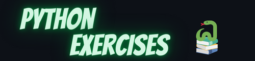

<p align="center"></p>


:information_source: &nbsp;Этот репозиторий содержит вопросы и упражнения для изучения и практики Python

:bar_chart: &nbsp;Сейчас здесь **231** упражнение и вопрос

- [Бесплатное приложение для изучения Python](#бесплатное-приложение-для-изучения-python)
- [Упражнения](#упражнения)
  - [Hello World](#hello-world)
  - [Объекты и типы данных](#объекты-и-типы-данных)
  - [Переменные](#переменные)
  - [Логические значения](#логические-значения)
  - [Строки](#строки)
  - [Числа](#числа)
  - [Списки и кортежи](#списки-и-кортежи)
  - [Словари](#словари)
  - [Циклы](#циклы)
  - [Функции](#функции)
  - [Классы](#классы)
  - [ООП](#ооп)
  - [Магические методы](#магические-методы)
  - [Модульное тестирование](#модульное-тестирование)
  - [Исключения](#исключения)
  - [Регулярные выражения](#регулярные-выражения)
  - [Файлы](#файлы)
  - [Операционные системы](#операционные-системы)
  - [Улучшите код](#улучшите-код)
  - [Аннотации типов](#аннотации-типов)
  - [Разное](#разное)
  - [Lambda](#lambda)
- [Вопросы](#вопросы)
  - [Hello World](#hello-world-1)
  - [Условные операторы](#условные-операторы)
  - [Циклы](#циклы-1)
  - [Классы](#классы-1)
  - [Строки](#строки-1)
  - [Списки](#списки)
      - [Python — ООП](#python--ооп)
      - [Python — исключения](#python--исключения)
      - [Встроенные функции Python](#встроенные-функции-python)
      - [Свойства](#свойства)
      - [Python — списки](#python--списки)
      - [Python — словари](#python--словари)
        - [Реализация распространённых алгоритмов](#реализация-распространённых-алгоритмов)
      - [Python — файлы](#python--файлы)
      - [Python — ОС](#python--ос)
      - [Python — регулярные выражения](#python--регулярные-выражения)
      - [Python — строки](#python--строки)
      - [Python — итераторы](#python--итераторы)
      - [Python — разное](#python--разное)
      - [Python — срезы](#python--срезы)
      - [Python — отладка](#python--отладка)
      - [Python — связный список](#python--связный-список)
      - [Python — стек](#python--стек)
      - [Python — тестирование](#python--тестирование)
      - [Flask](#flask)

# Бесплатное приложение для изучения Python

<p align="center">
  <a href="https://play.google.com/store/apps/details?id=com.codingshell.python_hero" target="_blank">
    
  </a>
</p>

# Упражнения

<a name="exercises-hello-world"></a>
## Hello World

|Название|Цель и инструкции|Решение|Комментарии|
|--------|--------|------|----|
| Hello World! | [Упражнение](exercises/hello_world/hello_world.md) | Решение](solutions/hello_world/hello_world.md | |
| Характеристики Python | [Упражнение](exercises/hello_world/python_characteristics.md) | [Решение](solutions/hello_world/python_characteristics.md) | |
| Каков результат? — уровень 1 | [Упражнение](exercises/hello_world/what_is_the_result_lvl_1.md) | [Решение](solutions/hello_world/what_is_the_result_lvl_1.md) | |
| Каков результат? — уровень 2 | [Упражнение](exercises/hello_world/what_is_the_result_lvl_2.md) | | |

<a name="exercises-objects"></a>
## Объекты и типы данных

|Название|Цель и инструкции|Решение|Комментарии|
|--------|--------|------|----|
| Объекты: основы | [Упражнение](exercises/data_types/objects_101.md) | [Решение](solutions/data_types/objects_101.md) | |
| Типы данных? Знаю парочку | [Упражнение](exercises/data_types/I_know_a_few.md) | [Решение](solutions/exceptions/I_know_a_few.md) | |
| Выбор типа данных — уровень 1 | [Упражнение](exercises/data_types/choose_datatype_level_1.md) | [Решение](solutions/data_types/choose_datatype_level_1.md) | |
| Выбор типа данных — уровень 2 | [Упражнение](exercises/data_types/choose_datatype_level_2.md) | [Решение](solutions/data_types/choose_datatype_level_2.md) | |
| Изменяемость | [Упражнение](exercises/data_types/mutability.md) | [Решение](solutions/data_types/mutability.md) | |
| Строгая типизация | [Упражнение](exercises/data_types/strongly_typed.md) | [Решение](solutions/data_types/strongly_typed.md) | |
| Создание объекта | [Упражнение](exercises/data_types/object_creation.md) | [Решение](solutions/data_types/object_creation.md) | |

<a name="exercises-variables"></a>
## Переменные

|Название|Цель и инструкции|Решение|Комментарии|
|--------|--------|------|----|
| Допустимые имена | [Упражнение](exercises/variables/valid_names.md) | [Решение](solutions/variables/valid_names.md) | |
| Области памяти или имена | [Упражнение](exercises/variables/locations_or_names.md) | [Решение](solutions/variables/locations_or_names.md) | |
| Типы | [Упражнение](exercises/variables/types.md) | [Решение](solutions/variables/types.md) | |
| Множественное присваивание | [Упражнение](exercises/variables/multiple_value_assigment.md) | [Решение](solutions/variables/multiple_value_assigment.md) | |
| Копирование переменных | [Упражнение](exercises/variables/copying_variables.md) | [Решение](solutions/variables/copying_variables.md) | |
| Изменяемые объекты | [Упражнение](exercises/variables/mutable_objects.md) | [Решение](solutions/variables/mutable_objects.md) | |

<a name="exercises-booleans"></a>
## Логические значения

|Название|Цель и инструкции|Решение|Комментарии|
|--------|--------|------|----|
| True или False? | [Упражнение](exercises/booleans/true_or_false.md) | [Решение](solutions/booleans/true_or_false.md) | |
| Преобразование | [Упражнение](exercises/booleans/conversion.md) | [Решение](solutions/booleans/conversion.md) | |

<a name="exercises-strings"></a>
## Строки

|Название|Цель и инструкции|Решение|Комментарии|
|--------|--------|------|----|
| 22 раза | [Упражнение](exercises/hello_world/22_times.md) | | |
| Переменные | [Упражнение](exercises/strings/variables.md) | [Решение](solutions/strings/variables.md) | |
| Каков результат? — уровень 1 | [Упражнение](exercises/strings/what_is_the_result_lvl_1.md) | [Решение](solutions/strings/what_is_the_result_lvl_1.md) | |
| Каков результат? — уровень 2 | [Упражнение](exercises/strings/what_is_the_result_lvl_2.md) | [Решение](solutions/strings/what_is_the_result_lvl_2.md) | |
| Начинается с буквы | [Упражнение](exercises/strings/letter_start.md) | [Решение](solutions/strings/letter_start.md) | |
| Изменение строк | [Упражнение](exercises/strings/change_strings.md) | [Решение](solutions/strings/change_strings.md) | |
| Все цифры | [Упражнение](exercises/strings/all_digits.md) | [Решение](solutions/strings/all_digits.md) | |
| Удаление символов | [Упражнение](exercises/strings/removing_characters.md) | [Решение](solutions/strings/removing_characters.md) | |
| Разворот строки | [Упражнение](exercises/strings/reverse_string.md) | [Решение](solutions/strings/reverse_string.md) | |
| Сжатие строк | [Упражнение](exercises/strings/compress_strings.md) | | |
| Срезы — уровень 1 | [Упражнение](exercises/strings/slicing_lvl_1.md) | [Решение](solutions/strings/slicing_lvl_1.md) | |
| Срезы — уровень 2 | [Упражнение](exercises/strings/slicing_lvl_2.md) | [Решение](solutions/strings/slicing_lvl_2.md) | |
| Смена регистра | [Упражнение](exercises/swap_case/exercise.md) | [Решение](exercises/swap_case/solution.py) | HackerRank |
| Подсчёт подстроки | [Упражнение](exercises/count_substring/exercise.md) | [Решение](exercises/count_substring/solution.py) | HackerRank |
| Capitalize! | [Упражнение](exercises/capitalize/exercise.md) | [Решение](exercises/capitalize/solution.py) | HackerRank |

<a name="exercises-numbers"></a>
## Числа

|Название|Цель и инструкции|Решение|Комментарии|
|--------|--------|------|----|
| Каков результат? | [Упражнение](exercises/numbers/what_is_the_result.md) | [Решение](solutions/numbers/what_is_the_result.md) | |
| Операции — уровень 1 | [Упражнение](exercises/numbers/operations_lvl_1.md) | [Решение](solutions/numbers/operations_lvl_1.md) | |
| Операции — уровень 2 | [Упражнение](exercises/numbers/operations_lvl_2.md) | [Решение](solutions/numbers/operations_lvl_2.md) | |
| Системы счисления | [Упражнение](exercises/numbers/bases.md) | [Решение](solutions/numbers/bases.md) | |
| Палиндром | [Упражнение](exercises/numbers/palindrome.md) | [Решение](solutions/numbers/palindrome.md) | |

<a name="exercises-lists"></a>
## Списки и кортежи

|Название|Цель и инструкции|Решение|Комментарии|
|--------|--------|------|----|
| Доступ к элементам списка | [Упражнение](exercises/hello_world/access_list_items.md) | [Решение](solutions/hello_world/access_list_items.md) | |
| Равные списки | [Упражнение](exercises/lists/equal_lists.md) | [Решение](solutions/lists/equal_lists.md) | |
| Длина | [Упражнение](exercises/hello_world/length.md) | | |
| Append и Insert | [Упражнение](exercises/lists/append_and_insert.md) | [Решение](solutions/lists/append_and_insert.md) | |
| Минимум и максимум | [Упражнение](exercises/lists/min_max.md) | [Решение](solutions/lists/min_max.md) | |
| Три наибольших элемента | [Упражнение](exercises/lists/three_biggest_items.md) | [Решение](solutions/lists/three_biggest_items.md) | |
| Каков результат? — уровень 1 | [Упражнение](exercises/lists/what_is_the_result_lvl_1.md) | [Решение](solutions/lists/what_is_the_result_lvl_1.md) | |
| Каков результат? — уровень 2 | [Упражнение](exercises/lists/what_is_the_result_lvl_2.md) | [Решение](solutions/lists/what_is_the_result_lvl_2.md) | |
| Накопительная сумма | [Упражнение](exercises/lists/running_sum/exercise.md) | [Решение](solutions/lists/running_sum/solution.py) | |
| Удаление дубликатов из отсортированного списка | [Упражнение](exercises/lists/remove_duplicates/exercise.md) | [Решение](exercises/lists/remove_duplicates/solution.py) | LeetCode |
| Найти второй результат! | [Упражнение](exercises/lists/find_the_runner_up_score/exercise.md) | [Решение](solutions/lists/find_the_runner_up_score/solution.py) | HackerRank |
| Вложенные списки | [Упражнение](exercises/lists/nested_lists/exercise.md) | [Решение](solutions/lists/nested_lists/solution.py) | HackerRank |

<a name="exercises-dictionaries"></a>
## Словари

|Название|Цель и инструкции|Решение|Комментарии|
|--------|--------|------|----|
| Только факты | [Упражнение](exercises/dicts/facts_only.md) | [Решение](solutions/dict/facts_only.md) | |

<a name="exercises-loops"></a>
## Циклы

|Название|Цель и инструкции|Решение|Комментарии|
|--------|--------|------|----|
| Выход из цикла | [Упражнение](exercises/loops/break_out.md) | [Решение](solutions/loops/break_out.md) | |
| Выход из цикла 2 | [Упражнение](exercises/loops/break_out.md) | [Решение](solutions/loops/break_out.md) | |
| Каждый символ | [Упражнение](exercises/loops/every_char.md) | [Решение](solutions/loops/every_char.md) | |
| Поток чисел | [Упражнение](exercises/loops/numbers_stream.md) | [Решение](solutions/loops/numbers_stream.md) | |
| Рефакторинг-1 | [Упражнение](exercises/loops/refactor_1.md) | [Решение](solutions/loops/refactor_1.py) | |

<a name="exercises-functions"></a>
## Функции

|Название|Цель и инструкции|Решение|Комментарии|
|--------|--------|------|----|
| Моя первая функция | [Упражнение](exercises/functions/my_first_function.md) | [Решение](solutions/functions/my_first_function.md) | |
| Калькулятор | [Упражнение](exercises/functions/calculator.md) | [Решение](solutions/functions/calculator.md) | |
| Объекты первого класса | [Упражнение](exercises/functions/first_class_objects.md) | [Решение](solutions/functions/first_class_objects.md) | |

<a name="exercises-classes"></a>
## Классы

|Название|Цель и инструкции|Решение|Комментарии|
|--------|--------|------|----|
| Классы 101 | [Упражнение](exercises/classes/101.md) | [Решение](solutions/classes/101.md) | |
| Атрибуты  | [Упражнение](exercises/classes/attributes/exercise.md) | [Решение](exercises/classes/attributes/solution.md) | |
| Порядок вывода | [Упражнение](exercises/classes/print_order/exercise.md) | [Решение](exercises/classes/print_order/solution.md)

<a name="exercises-oop"></a>
## ООП

|Название|Цель и инструкции|Решение|Комментарии|
|--------|--------|------|----|
| Наследование | [Упражнение](exercises/oop/inheritance.md) | [Решение](solutions/oop/inheritance.md) | |
 
## Магические методы

|Название|Цель и инструкции|Решение|Комментарии|
|--------|--------|------|----|
| Магический метод длины | [Упражнение](exercises/magic_methods/length.md) | | |

## Модульное тестирование

|Название|Цель и инструкции|Решение|Комментарии|
|--------|--------|------|----|
| Модульные тесты калькулятора | [Упражнение](exercises/unit_testing/calculator.md) | [Решение](solutions/unit_testing/calculator.md) | |
| Исправление модульных тестов калькулятора | [Упражнение](exercises/unit_testing/fix_calculator_tests.md) | | |

## Исключения

|Название|Цель и инструкции|Решение|Комментарии|
|--------|--------|------|----|
| Какое исключение будет выброшено? — уровень 1 | [Упражнение](exercises/exceptions/what_exception_is_raised_lvl_1.md) | [Решение](solutions/exceptions/what_exception_is_raised_lvl_1.md) | |
| Какое исключение будет выброшено? — уровень 2 | [Упражнение](exercises/exceptions/what_exception_is_raised_lvl_2.md) | [Решение](solutions/exceptions/what_exception_is_raised_lvl_2.md) | |
| Привязанный к нему | [Упражнение](exercises/exceptions/bound_to_it/exercise.md) | [Решение](exercises/exceptions/bound_to_it/solution.md)

## Регулярные выражения

|Название|Цель и инструкции|Решение|Комментарии|
|--------|--------|------|----|
| Замена в строках | [Упражнение](exercises/regex/substitute_strings.md) | [Решение](solutions/exceptions/substitute_strings.md) | |

## Файлы

|Название|Цель и инструкции|Решение|Комментарии|
|--------|--------|------|----|
| Чтение файла | [Упражнение](exercises/files/read_file.md) | | |
| Разворот файла | [Упражнение](exercises/files/reverse_file.md) | | |
| Вывод определённой строки | [Упражнение](exercises/files/print_specific_line.md) | | |

## Операционные системы

|Название|Цель и инструкции|Решение|Комментарии|
|--------|--------|------|----|
| Файл существует | [Упражнение](exercises/os/file_exists.md) | | |
| Вывести все файлы в каталоге | [Упражнение](exercises/os/print_all_files_in_dir.md) | | |

## Улучшите код

|Название|Цель и инструкции|Решение|Комментарии|
|--------|--------|------|----|
| If True | [Упражнение](exercises/improve_the_code/if_true.md) | [Решение](solutions/improve_the_code/if_true.md) | |
| Моржовый оператор | [Упражнение](exercises/improve_the_code/walrus.md) | [Решение](solutions/improve_the_code/walrus.md) | |
| Гласные буквы | [Упражнение](exercises/improve_the_code/vowel_letters.md) | [Решение](solutions/improve_the_code/vowel_letters.md) | |

## Аннотации типов

|Название|Цель и инструкции|Решение|Комментарии|
|--------|--------|------|----|
| Аннотации типов: только факты | [Упражнение](exercises/type_hinting/facts_only.md) | [Решение](solutions/type_hinting/facts_only.md) | |
| Плюсы и минусы | [Упражнение](exercises/type_hinting/pros_and_cons.md) | [Решение](solutions/type_hinting/pros_and_cons.md) | |
| Аннотации типов 101 | [Упражнение](exercises/type_hinting/type_hinting_101.md) | [Решение](solutions/type_hinting/type_hinting_101.md) | |
| Аннотации типов 102 | [Упражнение](exercises/type_hinting/type_hinting_102.md) | [Решение](solutions/type_hinting/type_hinting_102.md) | |

## Разное

|Название|Цель и инструкции|Решение|Комментарии|
|--------|--------|------|----|
| Случайное число | [Упражнение](exercises/misc/random_number.md) | | |
| Случайный элемент | [Упражнение](exercises/misc/random_item.md) | | |

## Lambda

|Название|Цель и инструкции|Решение||
|--------|--------|------|----|
| Перемножить аргументы и вернуть результат | [Упражнение](exercises/Lambda/Exe1.md) | [Решение](solutions/lambda/soluntion1.md) | |
| Написать программу на Python, которая создаёт функцию, удваивающую заданное число. | [Упражнение](exercises/Lambda/Exe2.md) | [Решение](solutions/lambda/solution2.md) | | |

# Вопросы

<a name="questions-hello-world"></a>
## Hello World

<details>
<summary>Как вывести "Hello World"?</summary><br><b>

`print("Hello World")`
</b></details>

<details>
<summary>Как вывести "Hello Amazing", а затем "World" на той же строке? (уточнение: нужно использовать две инструкции print)</summary><br><b>

```Python
print("Hello Amazing", end=" ")
print("World")
```
</b></details>

<details>
<summary>Следующая программа считывает два числа, введённых пользователем

```python
x = int(input())
y = int(input())
```

выведите сумму и разность этих чисел
</summary><br><b>

```python
print(x + y)
print(x - y)
```
</b></details>

## Условные операторы

<details>
<summary>Считайте число, введённое пользователем, и проверьте, чётное ли оно. Если чётное, выведите "yay". Если нет, выведите "nay"</summary><br><b>

```python
x = int(input())

if x % 2 == 0:
    print("yay")
else:
    print("nay")
```
</b></details>

## Циклы

<details>
<summary>дано целое число (n): выведите все числа от 0 до n (включая n)</summary><br><b>

```python
for i in range(n + 1):
    print(i)
```
</b></details>

<details>
<summary>дано целое число (n): выведите все чётные числа от 0 до n (включая n)</summary><br><b>

```python
for i in range(n + 1):
   if i % 2 == 0:
       print(i)
```
</b></details>

<a name="questions-classes"></a>
## Классы

<details>
<summary>Определите класс, который ничего не делает</summary><br><b>

```python
class SomeClass:
    pass
```
</b></details>

<details>
<summary>Верно или нет? Если <code>c</code> — экземпляр класса, то в <code>c.x = 1</code> <code>x</code> — это переменная со значением 1</summary><br><b>

Неверно. В случае `c.x = 1` `x` — это атрибут
</b></details>

<details>
<summary>Верно или нет? У каждого объекта в Python есть атрибуты</summary><br><b>

Верно. Атрибуты можно представлять как приватные словари, но вместо доступа через `[]` или `.get` к ним обращаются через точку.
</b></details>

<details>
<summary>Верно или нет? В отличие от переменных, атрибуты могут содержать не любой объект Python, а только несколько определённых типов</summary><br><b>

Неверно. Как и переменные, атрибуты могут содержать любой объект Python.
</b></details>

## Строки

<details>
<summary>Как преобразовать <code>"2 0 1 7"</code> в список <code>[2, 0, 1, 7]</code>?</summary><br><b>

```python
[int(i) for in in "2 0 1 7".split()]
```
</b></details>

## Списки

<details>
<summary>Как удалить дубликаты из заданного отсортированного списка?</summary><br><b>

```python

```
</b></details>

#### Python — ООП

<details>
<summary>Объясните, что такое наследование и как его использовать в Python</summary><br><b>
</b></details>

<details>
<summary>Объясните и продемонстрируйте атрибуты класса и атрибуты экземпляра</summary><br><b>

В следующем блоке кода `x` — атрибут класса, а `self.y` — атрибут экземпляра

```
class MyClass(object):
    x = 1

    def __init__(self, y):
        self.y = y
```
</b></details>

#### Python — исключения

<details>
<summary>Что такое ошибка? Что такое исключение? С какими типами исключений вы знакомы?</summary><br><b>

```
#  Обычно знать процесс компиляции не обязательно, но понимание того, откуда всё берётся,
#  и полные ответы показывают, что вы действительно разбираетесь в теме.

Generally, every compiling process have a two steps.
    - Analysis
    - Code Generation.

    Analysis can be broken into:
        1. Lexical analysis   (Tokenizes source code)
        2. Syntactic analysis (Check whether the tokens are legal or not, tldr, if syntax is correct)

               for i in 'foo'
                          ^
             SyntaxError: invalid syntax

        We missed ':'


        3. Semantic analysis  (Contextual analysis, legal syntax can still trigger errors, did you try to divide by 0,
          hash a mutable object or use an undeclared function?)

                 1/0
                ZeroDivisionError: division by zero

    These three analysis steps are the responsible for error handlings.

    The second step would be responsible for errors, mostly syntax errors, the most common error.
    The third step would be responsible for Exceptions.

    As we have seen, Exceptions are semantic errors, there are many builtin Exceptions:

        ImportError
        ValueError
        KeyError
        FileNotFoundError
        IndentationError
        IndexError
        ...

    You can also have user defined Exceptions that have to inherit from the `Exception` class, directly or indirectly.

    Basic example:

    class DividedBy2Error(Exception):
        def __init__(self, message):
            self.message = message


    def division(dividend,divisor):
        if divisor == 2:
            raise DividedBy2Error('I dont want you to divide by 2!')
        return dividend / divisor

    division(100, 2)

    >>> __main__.DividedBy2Error: I dont want you to divide by 2!
```
</b></details>

<details>
<summary>Объясните обработку исключений и как её использовать в Python</summary><br><b>

**Исключения:** ошибки, обнаруженные во время выполнения, называются исключениями (Exceptions).

**Обработка исключений:** когда возникает ошибка, или, как мы её называем, исключение, Python обычно останавливается и выводит сообщение об ошибке.</br>
Исключения можно обрабатывать с помощью инструкций `try` и `except` в Python.

**Пример:** следующий пример запрашивает у пользователя ввод, пока не будет введено корректное целое число. </br>
Если пользователь введёт нецелое значение, будет выброшено исключение; с помощью except оно будет перехвачено, и пользователя снова попросят ввести корректное целое число.


```py
while True:
    try:
        a = int(input("please enter an integer value: "))
        break
    except ValueError:
        print("Ops! Please enter a valid integer value.")

```

Подробнее об ошибках и исключениях: [https://docs.python.org/3/tutorial/errors.html](https://docs.python.org/3/tutorial/errors.html)

</b></details>

<details>
<summary>Каков результат выполнения следующей функции?

```
def true_or_false():
    try:
        return True
    finally:
        return False
```
</summary><br><b>
False
</b></details>

#### Встроенные функции Python

<details>
<summary>Объясните следующие встроенные функции (их назначение + пример использования):

  * repr
  * any
  * all</summary><br><b>
</b></details>

<details>
<summary>В чём разница между функциями repr и str?</summary><br><b>
</b></details>

<details>
<summary>Что такое метод __call__?</summary><br><b>

Он используется для эмуляции вызываемых объектов. Он позволяет вызывать экземпляр класса как функцию.

- Пример кода:

```
class Foo:
    def __init__(self: object) ->  None:
        pass
    def __call__(self: object) -> None:
        print("Called!")

f = Foo()
f()
```

- Результат:

```
Called!
```

</b></details>

<details>
<summary>Есть ли метод __call__ и у классов? Для чего?</summary><br><b>
</b></details>

<details>
<summary>Для чего в Python используется _?</summary><br><b>

1. Поиск перевода в i18n
2. Хранение результата последнего выполненного выражения или инструкции в интерактивном интерпретаторе.
3. Как универсальное имя «выбрасываемой» переменной. Например: x, y, _ = get_data() (x и y используются, а поскольку третья переменная не нужна, мы её «выбросили»).
</b></details>

<details>
<summary>Объясните, что такое GIL</summary><br><b>
	Python Global Interpreter Lock (GIL) — это разновидность блокировки процесса, которую Python использует при работе с процессами. Как правило, Python использует только один поток для выполнения набора написанных инструкций. Это значит, что в Python одновременно выполняется только один поток
</b></details>

<details>
<summary>Что такое Lambda? Как она используется?</summary><br><b>

Выражение <code>lambda</code> — это «анонимная» функция; от обычной функции, определённой с помощью ключевого слова `def``, она отличается синтаксисом и способом использования.

Синтаксис:

```lambda[parameters]: [expresion]```

**Примеры:**

* Lambda-функция, прибавляющая 10 к любому переданному аргументу.

```py
x = lambda a: a + 10
print(x(10))
```

* Функция сложения

```py
addition = lambda x, y: x + y
print(addition(10, 20))
```

* Функция возведения в квадрат

```py
square = lambda x : x ** 2
print(square(5))
```
Согласно PEP 8 присваивать lambda-выражение переменной обычно считается плохой практикой: они предназначены для использования в качестве параметров и внутри других определённых функций.

</b></details>

#### Свойства

<details>
<summary>Есть ли в Python приватные переменные? Как сделать атрибут класса приватным?</summary><br><b>
</b></details>

<details>
<summary>Объясните следующее:

* getter
* setter
* deleter</summary><br><b>
</b></details>

<details>
<summary>Объясните, что такое @property</summary><br><b>
</b></details>

<details>
<summary>Как поменять местами значения двух переменных?</summary><br><b>

```
x, y = y, x
```
</b></details>

<details>
<summary>Объясните следующие магические переменные объекта:

  * __dict__
</summary><br><b>
</b></details>

<details>
<summary>Напишите функцию, возвращающую сумму одного или нескольких чисел. Пользователь сам решает, сколько чисел использовать</summary><br><b>

Сначала нужно спросить у пользователя, сколько чисел будет использовано. Затем использовать цикл while, который выполняется, пока amount_of_numbers не станет 0, уменьшая amount_of_numbers на единицу на каждой итерации. В цикле while нужно запрашивать у пользователя число, которое на каждой итерации прибавляется к переменной.

```
def return_sum():
	amount_of_numbers = int(input("How many numbers? "))
	total_sum = 0
	while amount_of_numbers != 0:
		num = int(input("Input a number. "))
		total_sum += num
		amount_of_numbers -= 1
	return total_sum

```
</b></details>

<details>
<summary>Выведите среднее значение [2, 5, 6]. Оно должно быть округлено до 3 знаков после запятой</summary><br><b>

```
li = [2, 5, 6]
print("{0:.3f}".format(sum(li)/len(li)))
```
</b></details>

#### Python — списки

<details>
<summary>Что такое кортеж (tuple) в Python? Для чего он используется?</summary><br><b>

Кортеж — встроенный тип данных в Python. Он используется для хранения нескольких элементов в одной переменной.
</b></details>

<details>
<summary>Список (list), как и кортеж, тоже используется для хранения нескольких элементов. В чём тогда разница между кортежем и списком?</summary><br><b>

Список, в отличие от кортежа, — изменяемый тип данных. Это значит, что его можно изменять и добавлять в него элементы.
</b></details>

<details>
<summary>Как добавить число 2 в список <code>x = [1, 2, 3]</code></summary><br><b>

`x.append(2)`
</b></details>

<details>
<summary>Как получить последний элемент списка?</summary><br><b>

`some_list[-1]`
</b></details>

<details>
<summary>Как добавить элементы [1, 2, 3] в список [4, 5, 6]?</summary><br><b>
x = [4, 5, 6]
x.extend([1, 2, 3])

Не используйте `append`, если только не нужно добавить список как один элемент.
</b></details>

<details>
<summary>Как удалить первые 3 элемента из списка?</summary><br><b>

`my_list[0:3] = []`
</b></details>

<details>
<summary>Как вставить элемент в начало списка? А два элемента?</summary><br><b>

- Один элемент:

```
numbers = [1, 2, 3, 4, 5]
numbers.insert(0, 0)
print(numbers)
```

- Несколько элементов или список:

```
numbers_1 = [2, 3, 4, 5]
numbers_2 = [0, 1]
numbers_1 = numbers_2 + numbers_1
print(numbers_1)
```

</b></details>

<details>
<summary>Как отсортировать список по длине элементов?</summary><br><b>

```
sorted_li = sorted(li, key=len)
```

Или без создания нового списка:

```
li.sort(key=len)
```
</b></details>

<details>
<summary>В чём разница между list.sort() и sorted(list)?</summary><br><b>

* sorted(list) возвращает новый список (исходный список не меняется)
* list.sort() возвращает None, но список изменяется на месте (in-place)

* sorted() работает с любым итерируемым объектом (словари, строки, ...)
* list.sort() быстрее, чем sorted(list), в случае списков
</b></details>

<details>
<summary>Преобразуйте каждую строку в целое число: <code>[['1', '2', '3'], ['4', '5', '6']]</code></summary><br><b>

```
nested_li = [['1', '2', '3'], ['4', '5', '6']]
[[int(x) for x in li] for li in nested_li]
```
</b></details>

<details>
<summary>Как объединить два отсортированных списка в один отсортированный список?</summary><br><b>

```
sorted(li1 + li2)
```

Другой способ:

```
i, j = 0
merged_li = []

while i < len(li1) and j < len(li2):
    if li1[i] < li2[j]:
        merged_li.append(li1[i])
        i += 1
    else:
        merged_li.append(li2[j])
        j += 1

merged_li = merged_li + merged_li[i:] + merged_li[j:]
```
</b></details>

<details>
<summary>Как проверить, что все элементы заданного списка уникальны? То есть [1, 2, 3] — уникальный, а [1, 1, 2, 3] — нет, потому что 1 встречается дважды</summary><br><b>
</b>

Есть много способов решить эту задачу:<br>
<code># Note: :list and -> bool are just python typings, they are not needed for the correct execution of the algorithm. </code>

С использованием множеств (set) и len:

```
def is_unique(l:list) -> bool:
    return len(set(l)) == len(l)
```

Такой вариант можно встретить и в других языках программирования.

```
def is_unique2(l:list) -> bool:
    seen = []

    for i in l:
        if i in seen:
            return False
        seen.append(i)
    return True
```

Здесь мы просто считаем и проверяем, что каждый элемент встречается только один раз.

```
def is_unique3(l:list) -> bool:
    for i in l:
        if l.count(i) > 1:
            return False
    return True
```

Этот вариант может выглядеть более запутанным, но зато в одну строку.

```
def is_unique4(l:list) -> bool:
    return all(map(lambda x: l.count(x) < 2, l))
```
</details>

<details>
<summary>Есть следующая функция

```
def my_func(li = []):
    li.append("hmm")
    print(li)
```

Если вызвать её 3 раза, каким будет результат каждого вызова?
</summary><br><b>

```
['hmm']
['hmm', 'hmm']
['hmm', 'hmm', 'hmm']
```
</b></details>


<details>
<summary>Как перебрать элементы списка?</summary><br><b>

```
for item in some_list:
    print(item)
```
</b></details>

<details>
<summary>Как перебрать элементы списка вместе с индексами?</summary><br><b>

```
for i, item in enumerate(some_list):
    print(i)
```
</b></details>

<details>
<summary>Как начать перебор списка со 2-го индекса?</summary><br><b>

С помощью range, вот так

```
for i in range(1, len(some_list)):
    some_list[i]
```

Другой способ — использовать срез

```
for i in some_list[1:]:
```
</b></details>

<details>
<summary>Как перебрать список в обратном порядке?</summary><br><b>

Способ 1
```
for i in reversed(li):
    ...
```

Способ 2
```
n = len(li) - 1
while n > 0:
    ...
    n -= 1
```
</b></details>

<details>
<summary>Отсортируйте список списков по второму элементу каждого вложенного списка</summary><br><b>

```
li = [[1, 4], [2, 1], [3, 9], [4, 2], [4, 5]]

sorted(li, key=lambda l: l[1])
```

или

```
li.sort(key=lambda l: l[1)
```
</b></details>

<details>
<summary>Объедините [1, 2, 3] и ['x', 'y', 'z'] так, чтобы результат был [(1, 'x'), (2, 'y'), (3, 'z')]</summary><br><b>

```
nums = [1, 2, 3]
letters = ['x', 'y', 'z']

list(zip(nums, letters))
```
</b></details>

<details>
<summary>Что такое генератор списков (List Comprehension)? Лучше ли он обычного цикла? Почему? Продемонстрируйте, как его использовать</summary><br><b>

Из [документации](https://docs.python.org/3/tutorial/datastructures.html#list-comprehensions): «Генераторы списков дают лаконичный способ создавать списки. Типичное применение — создание новых списков, где каждый элемент является результатом некоторых операций, применённых к каждому элементу другой последовательности или итерируемого объекта, или создание подпоследовательности элементов, удовлетворяющих определённому условию.».

Он лучше, потому что компактнее, быстрее и лучше читается.

- Цикл for:

```
number_lists = [[1, 7, 3, 1], [13, 93, 23, 12], [123, 423, 456, 653, 124]]
odd_numbers = []
for number_list in number_lists:
    for number in number_list:
        if number % 2 == 0:
            odd_numbers.append(number)
print(odd_numbers)
```

- Генератор списка:

```
number_lists = [[1, 7, 3, 1], [13, 93, 23, 12], [123, 423, 456, 653, 124]]
odd_numbers = [number for number_list in number_lists for number in number_list if number % 2 == 0]
print(odd_numbers)
```

</b></details>

<details>
<summary>Есть следующий список: <code>[{'name': 'Mario', 'food': ['mushrooms', 'goombas']}, {'name': 'Luigi', 'food': ['mushrooms', 'turtles']}]</code>
  Извлеките все виды еды. Итоговый вывод должен быть таким: {'mushrooms', 'goombas', 'turtles'}</summary><br><b>

```
brothers_menu =  \
[{'name': 'Mario', 'food': ['mushrooms', 'goombas']}, {'name': 'Luigi', 'food': ['mushrooms', 'turtles']}]

# «Классический» способ
def get_food(brothers_menu) -> set:
    temp = []

    for brother in brothers_menu:
        for food in brother['food']:
            temp.append(food)

    return set(temp)

# Способ в одну строку (с помощью генератора списка)
set([food for bro in x for food in bro['food']])
```
</b></details>

#### Python — словари

<details>
<summary>Как создать словарь?</summary><br><b>

my_dict = dict(x=1, y=2)
ИЛИ
my_dict = {'x': 1, 'y': 2}
ИЛИ
my_dict = dict([('x', 1), ('y', 2)])
</b></details>

<details>
<summary>Как удалить ключ из словаря?</summary><br><b>

del my_dict['some_key']
также можно использовать `my_dict.pop('some_key')`, который возвращает значение ключа.
</b></details>

<details>
<summary>Как отсортировать словарь по значениям?</summary><br><b>

```
{k: v for k, v in sorted(x.items(), key=lambda item: item[1])}
```
</b></details>

<details>
<summary>Как отсортировать словарь по ключам?</summary><br><b>

```
dict(sorted(some_dictionary.items()))
```
</b></details>

<details>
<summary>Как объединить два словаря?</summary><br><b>

```
some_dict1.update(some_dict2)
```
</b></details>


<details>
<summary>Преобразуйте строку "a.b.c" в словарь <code>{'a': {'b': {'c': 1}}}</code></summary><br><b>

```
output = {}
string = "a.b.c"
path = string.split('.')
target = reduce(lambda d, k: d.setdefault(k, {}), path[:-1], output)
target[path[-1]] = 1
print(output)
```
</b></details>

##### Реализация распространённых алгоритмов

<details>
<summary>Реализуйте «бинарный поиск» (binary search) на Python</summary><br><b>

[Решение](coding/python/binary_search.py)
</b></details>

#### Python — файлы

<details>
<summary>Как записать данные в файл?</summary><br><b>

```
with open('file.txt', 'w') as file:
    file.write("My insightful comment")
```
</b></details>

<details>
<summary>Просуммируйте все целые числа в заданном файле</summary><br><b>
</b></details>

<details>
<summary>Выведите случайную строку заданного файла</summary><br><b>
</b></details>

<details>
<summary>Выведите каждую 3-ю строку заданного файла</summary><br><b>
</b></details>

<details>
<summary>Выведите количество строк в заданном файле</summary><br><b>
</b></details>

<details>
<summary>Выведите количество слов в заданном файле</summary><br><b>
</b></details>

<details>
<summary>Напишите функцию, которая выведет все файлы в заданном каталоге, включая подкаталоги</summary><br><b>
</b></details>

<details>
<summary>Запишите словарь (переменную) в файл</summary><br><b>

```
import json

with open('file.json', 'w') as f:
    f.write(json.dumps(dict_var))
```
</b></details>

#### Python — ОС

<details>
<summary>Как вывести текущий рабочий каталог?</summary><br><b>

    import os

    print(os.getcwd())

</b></details>

<details>
<summary>Дан путь <code>/dir1/dir2/file1</code>: выведите имя файла (file1)</summary><br><b>

    import os

    print(os.path.basename('/dir1/dir2/file1'))

    # Другой способ
    print(os.path.split('/dir1/dir2/file1')[1])

</b></details>

<details>
<summary>Дан путь <code>/dir1/dir2/file1</code>

1. Выведите путь без имени файла (/dir1/dir2)
2. Выведите имя каталога, в котором находится файл (dir2)
</summary><br><b>

    import os

    ## Часть 1.
    # os.path.dirname возвращает путь без последнего компонента
    dirpath = os.path.dirname('/dir1/dir2/file1')
    print(dirpath)

    ## Часть 2.
    print(os.path.basename(dirpath))

</b></details>

<details>
<summary>Как выполнять команды оболочки (shell) с помощью Python?</summary><br><b>
</b></details>

<details>
<summary>Как объединить компоненты пути? Например, <code>/home</code> и <code>luig</code> дадут <code>/home/luigi</code> </summary><br><b>
</b></details>

<details>
<summary>Как удалить непустой каталог?</summary><br><b>
</b></details>

#### Python — регулярные выражения

<details>
<summary>Как выполнять операции с регулярными выражениями в Python? (сопоставление с шаблоном, замена в строках и т.д.)</summary><br><b>

С помощью модуля re
</b></details>

<details>
<summary>Как найти все IP-адреса в переменной? А в файле?</summary><br><b>
</b></details>

#### Python — строки

<details>
<summary>Найдите первый повторяющийся символ в строке</summary><br><b>

При переборе символов сохранять их в словаре и для каждого символа проверять, есть ли он уже в словаре.

```
def firstRepeatedCharacter(str):
    chars = {}
    for ch in str:
        if ch in chars:
            return ch
        else:
            chars[ch] = 0
```
</b></details>

<details>
<summary>Как извлечь уникальные символы из строки? Например, для входной строки "itssssssameeeemarioooooo" вывод будет "mrtisaoe"</summary><br><b>

```
x = "itssssssameeeemarioooooo"
y = ''.join(set(x))
```
</b></details>

<details>
<summary>Найдите все перестановки заданной строки</summary><br><b>

```
def permute_string(string):

    if len(string) == 1:
        return [string]

    permutations = []
    for i in range(len(string)):
        swaps = permute_string(string[:i] + string[(i+1):])
        for swap in swaps:
            permutations.append(string[i] + swap)

    return permutations

print(permute_string("abc"))
```

Короткий способ (но, скорее всего, неприемлемый на собеседовании):

```
from itertools import permutations

[''.join(p) for p in permutations("abc")]
```

Подробный ответ можно найти здесь: http://codingshell.com/python-all-string-permutations

</b></details>

<details>
<summary>Как проверить, содержит ли строка подстроку?</summary><br><b>
</b></details>

<details>
<summary>Найдите частоту каждого символа в строке</summary><br><b>
</b></details>

<details>
<summary>Подсчитайте количество пробелов в строке</summary><br><b>

Можно использовать метод "count" вот так:

```python

ImAString.count(" ")

```

</b></details>

<details>
<summary>Дана строка: найдите N наиболее часто повторяющихся слов</summary><br><b>
</b></details>

<details>
<summary>Дана строка (представляющая матрицу) "1 2 3\n4 5 6\n7 8 9": создайте переменные строк и столбцов (они должны содержать целые числа, а не строки)</summary><br><b>
</b></details>

<details>
<summary>Каков результат каждого из следующих выражений?

```
>> ', '.join(["One", "Two", "Three"])
>> " ".join("welladsadgadoneadsadga".split("adsadga")[:2])
>> "".join(["c", "t", "o", "a", "o", "q", "l"])[0::2]
```
</summary><br><b>

```
>>> 'One, Two, Three'
>>> 'well done'
>>> 'cool'
```
</b></details>

<details>
<summary>Если <code>x = "pizza"</code>, каким будет результат <code>x[::-1]</code>?</summary><br><b>

Строка будет развёрнута, то есть x будет равно `azzip`.
</b></details>

<details>
<summary>Разверните каждое слово в строке (сохранив порядок слов)</summary><br><b>
</b></details>

<details>
<summary>Каков вывод следующего кода: <code>"".join(["a", "h", "m", "a", "h", "a", "n", "q", "r", "l", "o", "i", "f", "o", "o"])[2::3]</code></summary><br><b>

mario
</b></details>

#### Python — итераторы

<details>
<summary>Что такое итератор?</summary><br><b>
</b></details>

#### Python — разное

<details>
<summary>Объясните, что такое сериализация данных и как её выполнять в Python</summary><br><b>
</b></details>

<details>
<summary>Как обрабатывать (парсить) аргументы в Python?</summary><br><b>
</b></details>

<details>
<summary>Что такое генератор? Зачем использовать генераторы?</summary><br><b>
</b></details>

<details>
<summary>Каким будет вывод следующего блока?

```
for i in range(3, 3):
   print(i)
```
</summary><br><b>

Вывода не будет :)
</b></details>

<details>
<summary>Что такое <code>yeild</code>? Когда его использовать?</summary><br><b>
</b></details>

<details>
<summary>Объясните следующие типы методов и как их использовать:

  * Статический метод (static method)
  * Метод класса (class method)
  * Метод экземпляра (instance method)</summary><br><b>
</b></details>

<details>
<summary>Как развернуть список?</summary><br><b>
</b></details>

<details>
<summary>Как объединить список строк в одну строку с пробелами между ними</summary><br><b>
</b></details>

<details>
<summary>Есть следующий список вложенных списков: <code>[['Mario', 90], ['Geralt', 82], ['Gordon', 88]]</code> Как отсортировать список по числам во вложенных списках?</code></summary><br><b>

Один из способов:

the_list.sort(key=lambda x: x[1])
</b></details>

<details>
<summary>Объясните следующее:

  * zip()
  * map()
  * filter()</summary><br><b>
</b></details>

#### Python — срезы

В следующих упражнениях на срезы предполагается, что есть такой список: `my_list = [8, 2, 1, 10, 5, 4, 3, 9]`

<details>
<summary>Каков результат `my_list[0:4]`?</summary><br><b>
</b></details>

<details>
<summary>Каков результат `my_list[5:6]`?</summary><br><b>
</b></details>

<details>
<summary>Каков результат `my_list[5:5]`?</summary><br><b>
</b></details>

<details>
<summary>Каков результат `my_list[::-1]`?</summary><br><b>
</b></details>

<details>
<summary>Каков результат `my_list[::3]`?</summary><br><b>
</b></details>

<details>
<summary>Каков результат `my_list[2:]`?</summary><br><b>
</b></details>

<details>
<summary>Каков результат `my_list[:3]`?</summary><br><b>
</b></details>

#### Python — отладка

<details>
<summary>Как отлаживать код на Python?</summary><br><b>

pdb :D
</b></details>

<details>
<summary>Как проверить, сколько времени заняло выполнение определённого скрипта или блока кода?</summary><br><b>
</b></details>

<details>
<summary>Что возвращает пустой <code>return</code>?</summary><br><b>
</b>

Короткий ответ: он возвращает объект None.

Можно копнуть глубже и объяснить разницу между

```
def a ():
    return

>>> None
```

и

```
def a ():
    pass

>>> None
```
Или это могут спросить как следующий вопрос, поскольку оба варианта дают одинаковый результат.

Чтобы посмотреть, что происходит, можно использовать модуль dis:

```
  2           0 LOAD_CONST               0 (<code object a at 0x0000029C4D3C2DB0, file "<dis>", line 2>)
              2 LOAD_CONST               1 ('a')
              4 MAKE_FUNCTION            0
              6 STORE_NAME               0 (a)

  5           8 LOAD_CONST               2 (<code object b at 0x0000029C4D3C2ED0, file "<dis>", line 5>)
             10 LOAD_CONST               3 ('b')
             12 MAKE_FUNCTION            0
             14 STORE_NAME               1 (b)
             16 LOAD_CONST               4 (None)
             18 RETURN_VALUE

Disassembly of <code object a at 0x0000029C4D3C2DB0, file "<dis>", line 2>:
  3           0 LOAD_CONST               0 (None)
              2 RETURN_VALUE

Disassembly of <code object b at 0x0000029C4D3C2ED0, file "<dis>", line 5>:
  6           0 LOAD_CONST               0 (None)
              2 RETURN_VALUE
```

Пустой <code> return</code> — это в точности то же самое, что <code>return None</code>, а функции без явного return
всегда возвращают None независимо от выполняемых операций, поэтому


```
def sum(a, b):
    global c
    c = a + b

>>> None
```
</b></details>

<details>
<summary>Как улучшить следующий блок кода?

```
li = []
for i in range(1, 10):
    li.append(i)
```
</summary><br><b>

```
[i for i in range(1, 10)]
```
</b></details>

<details>
<summary>Дана следующая функция

```
def is_int(num):
    if isinstance(num, int):
        print('Yes')
    else:
        print('No')
```
Каким будет результат is_int(2) и is_int(False)?
</summary><br><b>
</b></details>

#### Python — связный список

<details>
<summary>Реализуйте связный список (linked list) на Python</summary><br><b>

Реализовывать его приходится потому, что связного списка нет в стандартной библиотеке Python.<br>
Чтобы реализовать связный список, нужно реализовать две структуры: сам связный список и узел (node), который используется связным списком.

Начнём с узла. У узла есть некоторое значение (данные, которые он хранит) и указатель на следующий узел

```
class Node(object):
    def __init__(self, data):
        self.data = data
        self.next = None
```

Теперь связный список. Пустой связный список не содержит ничего, кроме пустой головы (head).

```
class LinkedList(object):
    def __init__(self):
        self.head = None
```

Теперь можно начать использовать связный список

```
ll = Linkedlist()
ll.head = Node(1)
ll.head.next = Node(2)
ll.head.next.next = Node(3)
```

Получается следующее:

----       -----      ----
| 1 | ->   | 2 |  ->  | 3 |
----       -----      -----

Обычно реализуют и другие методы, например push_head(), который вставляет узел в начало связного списка

```
def push_head(self, value):
    new_node = Node(value)
    new_node.next = self.head
    self.head = new_node
```
</b></details>

<details>
<summary>Добавьте в класс Linked List метод для обхода связного списка (вывода данных каждого узла)</summary><br><b>

def print_list(self):
    node = self.head
    while(node):
        print(node.data)
        node = node.next
</b></details>

<details>
<summary>Напишите метод, который возвращает логическое значение в зависимости от того, есть ли цикл в связном списке</summary><br><b>

Воспользуемся алгоритмом поиска цикла Флойда (Floyd's Cycle-Finding algorithm):

```
def loop_exists(self):
    one_step_p = self.head
    two_steps_p = self.head
    while(one_step_p and two_steps_p and two_steps_p.next):
        one_step_p = self.head.next
        two_step_p = self.head.next.next
        if (one_step_p == two_steps_p):
            return True 
    return False
```
</b></details>

#### Python — стек

<details>
<summary>Реализуйте стек (Stack) на Python</summary><br><b>
</b></details>

#### Python — тестирование

<details>
<summary>Какой у вас опыт написания тестов на Python?</summary><br><b>
</b></details>

<details>
<summary>Что такое PEP8? Приведите пример 3 правил стиля</summary><br><b>

PEP8 — это набор соглашений о написании кода и правил стиля для Python

5 правил стиля:

    1. Ограничивать длину всех строк максимум 79 символами.
    2. Отделять определения функций и классов верхнего уровня двумя пустыми строками.
    3. Использовать запятую при создании кортежа из одного элемента
    4. Использовать для отступов пробелы (а не табуляцию)
    5. Использовать 4 пробела на каждый уровень отступа
</b></details>

<details>
<summary>Как проверить, было ли выброшено исключение?</summary><br><b>
</b></details>

<details>
<summary>Что делает <code>assert</code> в Python?</summary><br><b>
</b></details>

<details>
<summary>Объясните, что такое моки (mocks)</summary><br><b>
</b></details>

<details>
<summary>Как измерить время выполнения небольших фрагментов кода?</summary><br><b>
</b></details>

<details>
<summary>Почему не стоит использовать <code>assert</code> в нетестовом/продакшен-коде?</summary><br><b>
</b></details>

#### Flask

<details>
<summary>Опишите, что такое Django/Flask и как вы их использовали. Почему Flask, а не Django? (или наоборот)</summary><br><b>
</b></details>

<details>
<summary>Что такое маршрут (route)?</summary><br><b>
Как и любой веб-фреймворк, Flask предоставляет функциональность маршрутов, которая позволяет отдавать содержимое по заданному URL.

В Python есть несколько способов сопоставить URL с функцией.

- Декоратор: можно использовать декораторы Python. В данном случае используется `app`. Этот декоратор `app` — экземпляр класса `Flask`, а route — метод этого класса.

```
@app.route('/')
def home():
  return 'main website'
```

- Метод `add_url_rule`: это метод класса Flask. Его тоже можно использовать для сопоставления URL с функцией.

```
def home():
  return 'main website'

app.add_url_rule('/', view_func=home)
