

> Проект с открытым исходным кодом, который помогает шаг за шагом изучать проектирование систем

**ПРИМЕЧАНИЕ:** работа над этим репозиторием ещё продолжается. Некоторая информация на данный момент может быть неполной или отсутствовать.

* [Темы](#topics)
* [Объяснение тем](#topics-explained)
* [Упражнения](#упражнения)
  * [Общие](#общие)
  * [AWS Cloud](#aws-cloud)
  * [Разное](#misc-exercises)
* [Вопросы](#вопросы)
* [Ресурсы](#ресурсы)
* [Проектирование систем](#примеры-проектирования-систем)
  * [Облако](#system-design-cloud)
  * [Разработка](#system-design-development)
  * [Типовые системы](#system-design-generic-systems)
  * [Реальные системы](#system-design-real-world-systems)
* [Процесс проектирования системы](#процесс-проектирования-системы)
* [Советы для собеседования](#советы-для-собеседования-по-проектированию-систем)
* [Вопросы и ответы](common-qa.md)
* [Благодарности](credits.md)

## Проектирование систем

### Требования

<!-- ALL-TOPICS-LIST:START -->
<!-- prettier-ignore-start -->
<!-- markdownlint-disable -->

<table>
  <tr>
    <td align="center"><a href="requirements/README.md"> <b>Требования</b></a></td>
    <td align="center"><a href="requirements/README.md#функциональные-требования"> <b>Функциональные требования</b></a></td>
    <td align="center"><a href="requirements/README.md#нефункциональные-требования"> <b>Нефункциональные требования</b></a></td>
  </tr>
</table>

<!-- markdownlint-enable -->
<!-- prettier-ignore-end -->
<!-- ALL-TOPICS-LIST:END -->

### Компоненты/сервисы

<!-- ALL-TOPICS-LIST:START -->
<!-- prettier-ignore-start -->
<!-- markdownlint-disable -->

<table>
  <tr>
    <td align="center"><a href="basic_architecture/README.md"> <b>Сервер</b></a></td>
    <td align="center"><a href="basic_architecture/README.md"> <b>Клиент</b></a></td>
      <td align="center"><a href="services/load_balancer/README.md">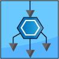 <b>Балансировщик нагрузки</b></a></td>
    <td align="center"><a href="services/api_gateway/README.md"> <b>API Gateway</b></a></td>
    <td align="center"><a href="services/dns/README.md"> <b>DNS</b></a></td>
  </tr>
</table>

<!-- markdownlint-enable -->
<!-- prettier-ignore-end -->
<!-- ALL-TOPICS-LIST:END -->

### Масштабируемость
<!-- ALL-TOPICS-LIST:START -->
<!-- prettier-ignore-start -->
<!-- markdownlint-disable -->

<table>
  <tr>
    <td align="center"><a href="scalability/README.md"> <b>Масштабируемость</b></a></td>
    <td align="center"><a href="scalability/README.md#горизонтальное-масштабирование">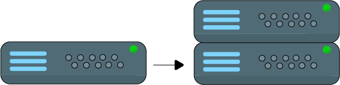 <b>Горизонтальное масштабирование</b></a></td>
    <td align="center"><a href="scalability/README.md"> <b>Вертикальное масштабирование</b></a></td>
    <td align="center"><a href="scalability/README.md#коэффициент-масштабируемости"> <b>Коэффициент масштабируемости</b></a></td>
    
  </tr>
</table>

<!-- markdownlint-enable -->
<!-- prettier-ignore-end -->
<!-- ALL-TOPICS-LIST:END -->

### Инженерия надёжности
<!-- ALL-TOPICS-LIST:START -->
<!-- prettier-ignore-start -->
<!-- markdownlint-disable -->

<table>
  <tr>
    <td align="center"><a href="reliability_engineering/README.md"> <b>Доступность</b></a></td>
    <td align="center"><a href="reliability_engineering/README.md"> <b>Failover</b></a></td>
  </tr>
  <tr>
    <td align="center"><a href="reliability_engineering/README.md#cold-standby"> <b>Cold Standby</b></a></td>
    <td align="center"><a href="reliability_engineering/README.md#warm-standby"> <b>Warm Standby</b></a></td>
     <td align="center"><a href="reliability_engineering/README.md#hot-standby"> <b>Hot Standby</b></a></td>
  </tr>
</table>

<!-- markdownlint-enable -->
<!-- prettier-ignore-end -->
<!-- ALL-TOPICS-LIST:END -->

### Сети
<!-- ALL-TOPICS-LIST:START -->
<!-- prettier-ignore-start -->
<!-- markdownlint-disable -->

<table>
  <tr>
    <td align="center"><a href="networking/README.md"> <b>Сети</b></a></td>
  </tr>
</table>

<!-- markdownlint-enable -->
<!-- prettier-ignore-end -->
<!-- ALL-TOPICS-LIST:END -->

### Базы данных
<!-- ALL-TOPICS-LIST:START -->
<!-- prettier-ignore-start -->
<!-- markdownlint-disable -->

<table>
  <tr>
    <td align="center"><a href="databases/README.md"> <b>Базы данных</b></a></td>
    <td align="center"><a href="databases/README.md#теорема-cap">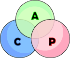 <b>Теорема CAP</b></a></td>
  </tr>
</table>

<!-- markdownlint-enable -->
<!-- prettier-ignore-end -->
<!-- ALL-TOPICS-LIST:END -->

### Распределённые системы
<!-- ALL-TOPICS-LIST:START -->
<!-- prettier-ignore-start -->
<!-- markdownlint-disable -->

<table>
  <tr>
    <td align="center"><a href="distributed_systems/README.md">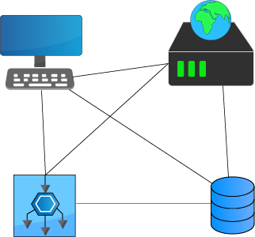 <b>Распределённые системы</b></a></td>
    <td align="center"><a href="distributed_systems/README.md#дрейф-часов"> <b>Дрейф часов</b></a></td>
    <td align="center"><a href="distributed_systems/README.md#cdn">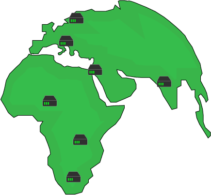 <b>CDN</b></a></td>
  </tr>
</table>

<!-- markdownlint-enable -->
<!-- prettier-ignore-end -->
<!-- ALL-TOPICS-LIST:END -->

### Базы данных
<!-- ALL-TOPICS-LIST:START -->
<!-- prettier-ignore-start -->
<!-- markdownlint-disable -->

<table>
  <tr>
 
  </tr>
</table>

<!-- markdownlint-enable -->
<!-- prettier-ignore-end -->
<!-- ALL-TOPICS-LIST:END -->
  <td align="center"><a href="reliability_engineering/README.md"> <b></b></a></td>

## Упражнения
### Общие
#### «Элементарно, мой дорогой Ватсон»

Ниже показана архитектура сервера, на котором работают веб-сервер и база данных. К серверу подключается десяток клиентов. Ответьте на следующие вопросы

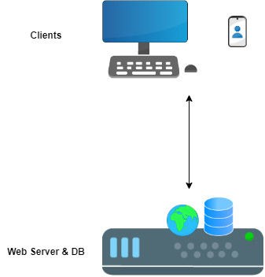

1. Назовите две проблемы этой архитектуры
   - Какой термин/понятие проектирования систем описывает одну из названных проблем?
2. Предложите улучшение архитектуры **БЕЗ** добавления новых компонентов
   1. Если предлагаемое улучшение — «вертикальное масштабирование», является ли оно постоянным?
3. Предложите два улучшения архитектуры при условии, что можно добавлять новые компоненты

 <b>

1. Две проблемы:
   1. Единая точка отказа: если сервер выйдет из строя, пользователи не смогут подключиться к приложению, и сервер придётся восстанавливать или создавать с нуля
   2. Если веб-процесс использует всю оперативную память и/или процессор, это может повлиять на БД, так как ей не хватит ресурсов для обработки запросов. Верно и обратное: БД может потреблять все ресурсы, не оставляя достаточно процессам веб-сервера.
      - Термин, описывающий эту проблему, — «масштабируемость». Сервер не масштабируется по мере роста потребностей, и в итоге пользователи столкнутся с проблемами

2. Применить [вертикальное масштабирование](#vertical-scaling). Добавление серверу ресурсов (т.е. процессора и оперативной памяти) позволит ему выдерживать большую нагрузку. Это не постоянное решение, так как в какой-то момент нагрузка может вырасти до уровня, когда добавить экземпляру оперативной памяти и процессоров уже невозможно или это просто нецелесообразно.

3. Два улучшения:
   1. Разделить БД и веб-сервер на два компонента (вместо того чтобы оба работали на одном экземпляре)
   2. Применить [горизонтальное масштабирование](#horizontal-scaling) — добавить больше веб-серверов (можно также добавить больше экземпляров БД)

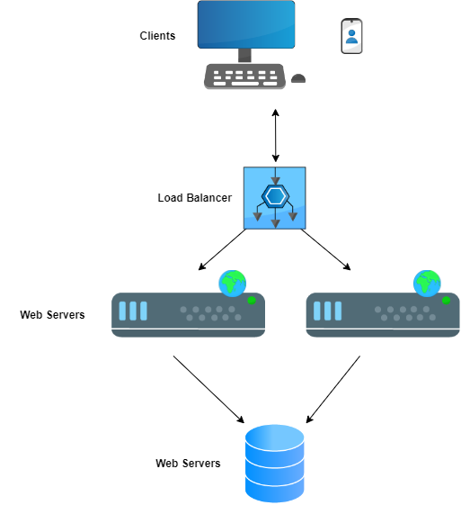

</b>

### AWS Cloud

#### Который час? (приложение без состояния)

Спроектируйте простейшую архитектуру веб-приложения (на базе сервера), которое сообщает одному пользователю, который час (без БД, без масштабирования, ...), используя не более двух компонентов

 <b>

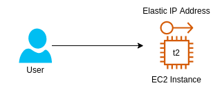

В этом случае нужны два компонента:

* Экземпляр EC2 — здесь будет работать приложение. Базового экземпляра micro t2 более чем достаточно
* Elastic IP address — статический IP-адрес, который пользователь будет каждый раз использовать для доступа к приложению. Если экземпляр перестанет работать, IP-адрес всегда можно перенести на работающий (если управляется больше одного экземпляра)
</b>

Веб-приложение стало очень успешным, и им начали пользоваться многие пользователи. Какая проблема может возникнуть при переходе от одного пользователя ко многим и как справиться с ней с помощью одного улучшения архитектуры?

 <b>

Экземпляр может оказаться недостаточно мощным для обработки запросов от множества пользователей, и довольно скоро оперативная память и процессор могут оказаться загружены полностью. Один из способов справиться с этим — выполнить так называемое «вертикальное масштабирование», то есть добавить экземпляру ресурсов. В случае AWS — перейти на тип экземпляра с большим количеством ресурсов, например M5.

Примечание: проблема вертикального масштабирования (при одном узле) — простой (при смене типа экземпляра он будет недоступен), поэтому стоит также выполнить «горизонтальное масштабирование», то есть добавить экземпляров/ресурсов.

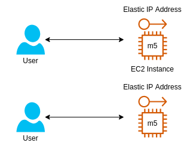

</b>

Нужно изменить предложенную в решении архитектуру так, чтобы не использовать elastic IP addresses по очевидной причине: это плохо масштабируется (у каждого экземпляра EC2 свой IP, и пользователи не могут запомнить их все). Предложите улучшение

 <b>

Вместо elastic IP addresses можно добавить запись в DNS с помощью сервиса Route 53 — запись типа A. Так все пользователи смогут обращаться к приложению по имени хоста, а IP-адрес им будет выдавать DNS

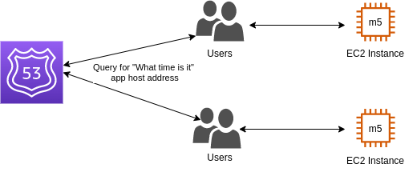

Важно отметить, что это решение не оптимально, если в какой-то момент планируется масштабирование вниз и вверх. Из-за значения TTL записи пользователь будет продолжать обращаться к тому же IP-адресу, даже если узел уже не работает.

Более правильной и полной архитектурой будет использование ELB

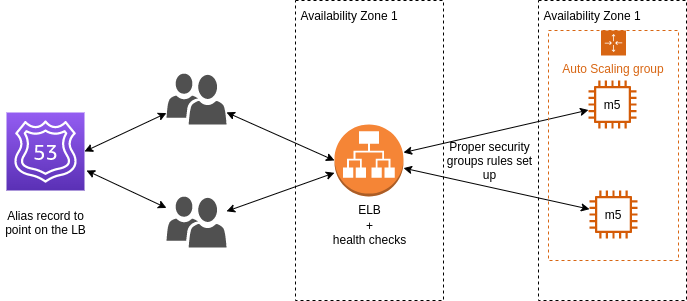

Но даже с ELB и «Auto scaling group» для автоматического масштабирования узлов эта архитектура не оптимальна. Какая проблема есть у текущей архитектуры? (с двух разных точек зрения)
</b>

Назовите проблемы текущей архитектуры и что можно улучшить

 <b>

В текущей архитектуре приложение, возможно, способно масштабироваться вверх и вниз, но если зона доступности (availability zone) выходит из строя, всё приложение становится недоступным. Поэтому первым улучшением будет сделать и ELB, и само приложение (экземпляры EC2) multi-AZ.

Во-вторых, если известно, что приложению всегда нужен один экземпляр (или два), имеет смысл использовать зарезервированные узлы (reserved nodes). Зарезервированные узлы означают, что за экземпляры платится меньше, то есть экономятся затраты.

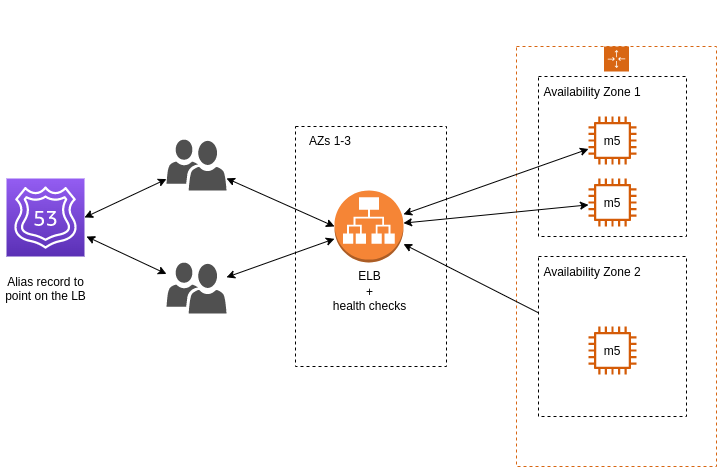

</b>

#### «Магазин видеоигр» (приложение с состоянием)

Для онлайн-магазина видеоигр была предложена следующая архитектура со следующими требованиями:

  * Поддерживать тысячи пользователей в любой момент времени
  * Пользователи могут регистрироваться
  * Товары в корзине не должны теряться, пока пользователь просматривает магазин

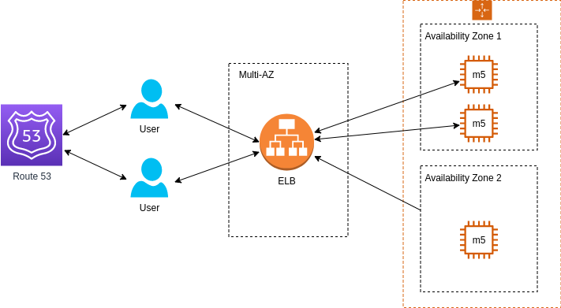

Проблема в том, что пользователи сообщают: когда они просматривают другие видеоигры для покупки, их корзина теряется. В чём проблема текущей архитектуры и как с ней справиться?

 <b>

Такое приложение является приложением с состоянием (stateful), то есть важно сохранять информацию о клиенте от одной сессии к другой. Похоже, что в текущей архитектуре каждый раз, когда пользователь начинает новую сессию, она выполняется на другом экземпляре без сохранения информации о клиенте.

В этом случае можно применить пару решений:
  * Sticky Sessions балансировщика нагрузки: пользователи будут перенаправляться на тот экземпляр, с которым они ранее начали сессию, чтобы не терять данные клиента. Недостаток здесь в потере
  * Пользовательские cookies: клиент/пользователь хранит нужные данные (в данном случае корзину), и тогда неважно, с каким экземпляром EC2 взаимодействует пользователь, — данные корзины будут отправляться от клиента/пользователя на нужный экземпляр. Недостатки: HTTP-запросы становятся намного тяжелее, так как данные прикрепляются к каждому запросу, и есть определённые риски безопасности, так как cookies потенциально могут быть изменены
</b>

#### «Магазин видеоигр»

В продолжение предыдущего упражнения: есть ли другой способ работы с данными пользователя (кратко- и долгосрочными), кроме пользовательских cookies и sticky sessions?

 <b>

Есть так называемая «серверная сессия» (server session), для которой нужно добавить в архитектуру новый компонент — ElastiCache или DynamoDB — для хранения данных корзины каждого пользователя. Для её идентификации используется идентификатор сессии (session ID), который клиент/пользователь отправляет с каждым запросом

Для долгосрочных данных (имя пользователя, адрес и т.д.) используется база данных (например, RDS). Есть несколько вариантов её использования. Главный экземпляр (master), в который записываются данные, и реплика, из которой они читаются:

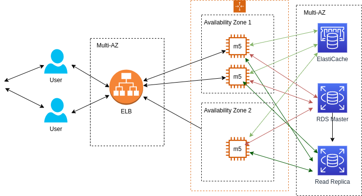

Другой подход — использовать кэш + БД: для каждой сессии проверяется, есть ли данные в кэше, и если нет, выполняется обращение к БД (это также называют «Write Through»): 

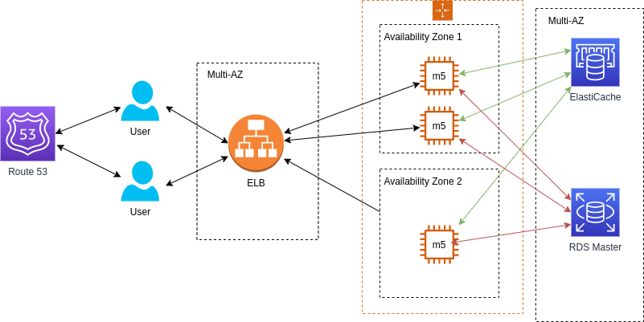

</b>

### Разное

Примечание: упражнения могут повторяться в разных вариантах, чтобы отработать и подчеркнуть разные понятия.

#### «Идеальный баланс, как и должно быть во всём»

Есть следующая простая архитектура: сервер обрабатывает запросы от клиента. Каковы недостатки этой архитектуры и как её улучшить?

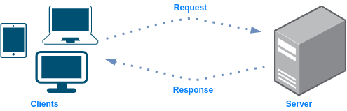

 <b>

* Ограничения:
  * Нагрузка: в какой-то момент сервер может оказаться не в состоянии обрабатывать больше запросов, и он откажет или начнёт вызывать задержки
  * Единая точка отказа: если сервер выйдет из строя, обрабатывать запросы будет нечему

* Как улучшить: 
  

  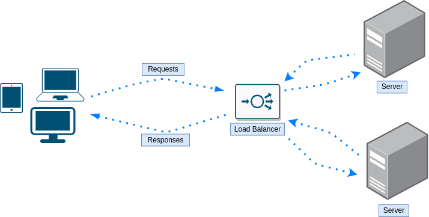
  

* Дальнейшие ограничения:
    * Проблемы нагрузки и сервера как единой точки отказа решены, но теперь единой точкой отказа стал балансировщик нагрузки.
</b>

Можно ли улучшить архитектуру выше, не добавляя отдельный экземпляр балансировщика нагрузки?
 <b>

Да, можно использовать балансировку нагрузки с помощью DNS. 
Дополнительный вопрос: какой алгоритм будет использовать DNS-балансировщик нагрузки?
</b>

Каковы недостатки алгоритма round robin при балансировке нагрузки?
 <b>

  * Простой алгоритм round robin ничего не знает о нагрузке и характеристиках каждого сервера, которому он перенаправляет запросы. Возможно, что несколько тяжёлых запросов попадут на один и тот же сервер, а другие серверы получат только лёгкие запросы. В результате один сервер будет выполнять большую часть работы и, возможно, в какой-то момент даже упадёт, потому что не сможет в одиночку обработать все тяжёлые запросы.
  * Каждый запрос клиента создаёт совершенно новую сессию. Это может быть проблемой в сценариях, где нужно выполнить несколько операций и сервер должен знать результат предыдущей операции, то есть по сути учитывать историю взаимодействия с клиентом. При round robin первый запрос может попасть на сервер X, а второй — на сервер Y с просьбой продолжить обработку данных, которые уже обрабатывались на сервере X.
</b>

#### «За все мои поступки, публичные и личные»

Ниже показана архитектура: балансировщик нагрузки и три веб-сервера. Если нужна разумная защищённая архитектура, где следует назначить публичный IP, а где — частный? 

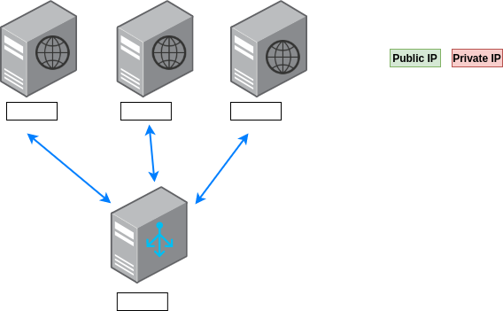

 <b>

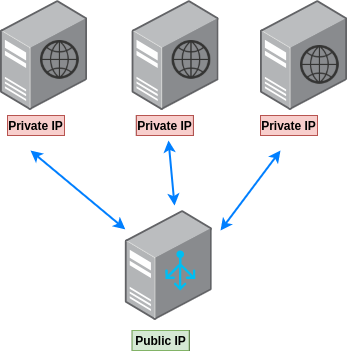

Имеет смысл спрятать веб-серверы за балансировщиками нагрузки, а не давать пользователям прямой доступ к ним, поэтому каждому из них будет назначен частный IP.
Балансировщику нагрузки нужен публичный IP, так как ожидается, что все, кто хочет обратиться к определённой веб-странице/ресурсу, будут проходить через балансировщик нагрузки, а значит, он должен быть доступен пользователям.
</b>

Какие существуют методы балансировки нагрузки?
 <b>

  * Round Robin
  * Weighted Round Robin
  * Least Connection
  * Weighted Least Connection
  * Resource Based
  * Fixed Weighting
  * Weighted Response Time
  * Source IP Hash
  * URL Hash
</b>

#### «Спокойно, мне нужны только твои деньги»

Ниже показана простая архитектура: клиент отправляет запросы веб-серверу, который, в свою очередь, получает данные из хранилища данных. Каковы недостатки этой архитектуры и как её улучшить?

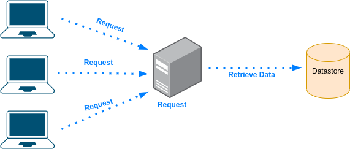

 <b>

* Ограничения:
  * Время: получение данных из хранилища при каждом запросе клиента может занимать много времени
  * Единая точка отказа: если хранилище данных недоступно (или даже просто медленное), обрабатывать запросы будет невозможно
  * Нагрузка: хранилище данных, получающее все запросы, может испытывать высокую нагрузку, что может привести к простою

* Как улучшить: 
  

  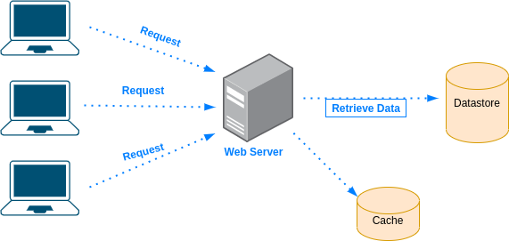
  

</b>

Объясните, что такое кэш и в каких случаях его стоит использовать?
 <b>

Зачем использовать кэш?

  * Экономия времени: обращение к удалённому хранилищу данных и вообще сетевые вызовы занимают время
  * Снижение нагрузки: вместо того чтобы хранилище данных обрабатывало все запросы, можно снять с него часть нагрузки за счёт обращения к кэшу
  * Избежание повторяющихся задач: вместо того чтобы каждый раз запрашивать и обрабатывать данные, сделать это один раз и сохранить результат в кэше
</b>

Почему бы не хранить в кэше всё?
 <b>

По нескольким причинам:

1. Оборудование, на котором хранится кэш, в некоторых случаях намного дороже
2. Чем больше данных в кэше, тем он больше и тем дольше выполняются операции put/get
</b>

#### «Давным-давно в далёкой-далёкой галактике...»

Ниже показана архитектура: удалённая база данных и три сервера приложений

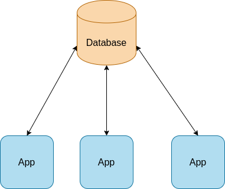

 <b>

* Ограничения:
  * Задержка. Каждый запрос к удалённой базе данных будет сталкиваться с задержкой, пусть и небольшой.
  * Если удалённая база данных упадёт, приложение перестанет работать

* Как улучшить: 
  

  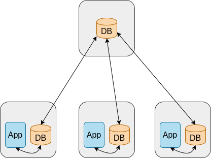
  

  * Реплицировать каждую базу данных на локальный сервер приложения. У этого есть несколько преимуществ. Во-первых, мы больше не зависим от задержки. Во-вторых, сбо

* Дальнейшие ограничения:
  * Теперь мы зависим от пропускной способности
  * Если удалённая база данных долго недоступна, у нас будет устаревшая база данных, и каждое приложение потенциально может работать с разной БД
</b>

#### «Немного медленновато»

Ниже показано улучшение предыдущей архитектуры

 <b>

* Ограничения:
  * Запросы к базе данных могут быть медленными даже на самом сервере, где работает приложение
  * Когда удалённая база данных недоступна, локальные базы данных не будут синхронизированы

* Как улучшить: 
  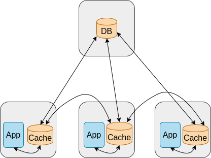
</b>

#### «Всегда один и тот же»

Каждый запрос от одного и того же клиента каждый раз направляется на другой веб-сервер. С какой проблемой может столкнуться пользователь при такой архитектуре? Как это исправить?

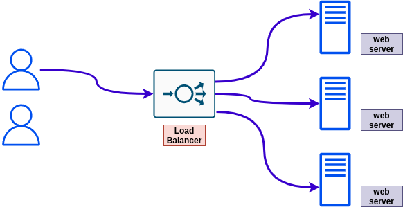

 <b>

* Проблема: пользователю, возможно, придётся проходить аутентификацию при каждом запросе, так как его запросы обрабатывают разные веб-серверы.
* Возможное решение: использовать sticky sessions, при которых пользователь каждый раз направляется на один и тот же экземпляр

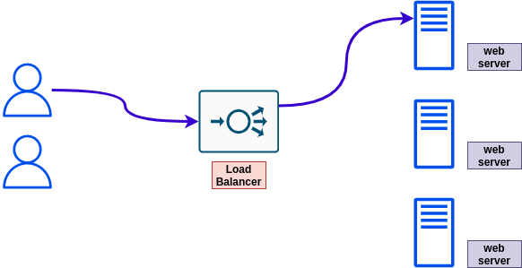
</b>

#### «Возвращаемся и видим, что потерпели неудачу»

Есть архитектура с балансировщиком нагрузки и несколькими веб-экземплярами за ним. Иногда экземпляры падают, и пользователи сообщают, что приложение у них не работает. Назовите один возможный способ справиться с такой ситуацией.
 <b>

Один из возможных способов — использовать проверки работоспособности (health checks). Экземпляр, не прошедший проверку, исключается из списка экземпляров, на которые балансировщик нагрузки перенаправляет трафик.
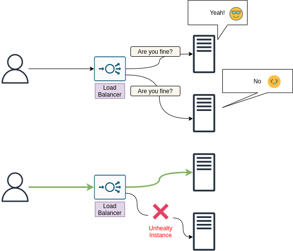
</b>

#### «В любом большом городе не лезть в чужие дела — это целая наука»

Есть рабочее (production) приложение, использующее базу данных для чтения и записи. Организация хочет добавить ещё одно приложение, работающее с той же базой данных, но для аналитики (только чтение). Какая проблема может возникнуть в этой новой ситуации и какое одно улучшение можно внести в архитектуру?

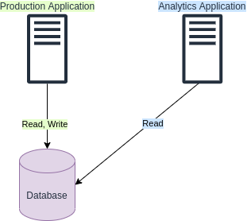

 <b>

Добавление ещё одного приложения, работающего с той же базой данных, может создать на неё дополнительную нагрузку, что может привести к проблемам, так как дополнительная нагрузка может достичь пределов ёмкости базы данных.

Одним из улучшений архитектуры может быть добавление экземпляра реплики для чтения (read replica) базы данных. Тогда новое приложение сможет работать с репликой для чтения, а не с исходной базой данных. Репликация будет асинхронной, но в большинстве случаев для аналитических приложений этого достаточно.

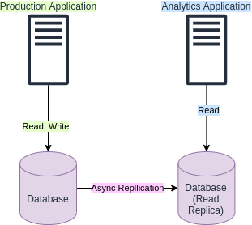
</b>

## Вопросы

Это более «упрощённая» версия раздела упражнений. Никаких схем, никаких развивающихся упражнений, никаких странных названий — просто прямые вопросы, каждый в своей категории.

Веб-сайт обычно обслуживает в среднем десяток пользователей, и загрузка процессора и оперативной памяти в норме. Внезапно он становится очень популярным, и многие пользователи пытаются обратиться к веб-серверу, но сталкиваются с проблемами, а загрузка процессора и оперативной памяти, похоже, достигает 100%. Как описать эту проблему?
 <b>

Проблема масштабируемости. Веб-сервер не масштабируется :'( 
Чтобы избежать таких проблем, веб-сервер должен масштабироваться в зависимости от использования. Больше пользователей -> выше загрузка процессора и оперативной памяти -> добавить ресурсы (= масштабирование вверх). An
Когда пользователей, обращающихся к сайту, становится меньше, — масштабирование вниз.
</b>

### Кэш

Расскажите всё, что знаете о кэше
 <b>
</b>

Правда или ложь? Хотя кэширование может сократить время загрузки, оно увеличивает нагрузку на сервер
 <b>

Ложь. Если серверу не нужно выполнять запрос, так как результат уже есть в кэше, то на самом деле всё наоборот: нагрузка на сервер меньше, а время загрузки к тому же сокращается.
</b>

### DNS

Что такое DNS?
 <b>
</b>

Можно ли использовать DNS для балансировки нагрузки?
 <b>
</b>

### Хранилище

Что такое RAID?
 <b>
</b>

### DNS

Что такое CDN?
 <b>
</b>

### Разное

Как операционные системы могут выполнять задачи одновременно? Например, открыть веб-браузер во время запуска игры
 <b>

У процессора несколько ядер. Каждая задача выполняется отдельным ядром. 
Кроме того, может лишь казаться, что задачи выполняются одновременно. Если каждый процесс получает процессорное время каждую наносекунду, пользователь может подумать, что оба процесса работают одновременно.
</b>

Что такое VPS?
 <b>

[Из Wikipedia](https://en.wikipedia.org/wiki/Virtual_private_server): «Виртуальный частный сервер (VPS) — это виртуальная машина, продаваемая как услуга провайдером интернет-хостинга.»
</b>

Правда или ложь? VPS — это, по сути, общий сервер, где каждому пользователю выделяется часть ОС сервера
 <b>

Ложь. Предоставляется частная ВМ, которую больше никто не может и не должен использовать.
</b>

### Распределённые системы

С какими проблемами приходится сталкиваться при проектировании и управлении распределёнными системами, но в гораздо меньшей степени — при работе с системами/сервисами, работающими на одном хосте?
 <b>

См. [Распределённые системы - заблуждения о распределённых системах](#fallacies-of-distributed-systems)
</b>

Что такое дрейф часов (clock drift) применительно к распределённым системам?
 <b>

См. [Распределённые системы - дрейф часов](#clock-drift)
</b>

## Ресурсы

Существует множество отличных ресурсов для изучения проектирования систем разными способами — видео, блоги и т.д. Некоторые из них собраны здесь

### По темам

  
Введение в проектирование систем

#### Статьи
* [Introduction To Systems Design - 2020](https://medium.com/swlh/introduction-to-systems-design-9bdab73fb8)

  
Масштабируемость

#### Видео
* [Harvard Scalability Lecture - 2012](https://www.youtube.com/watch?v=-W9F__D3oY4&ab_channel=JorgeScott)

#### Репозитории
* [awesome-scalability](https://github.com/binhnguyennus/awesome-scalability) - «Актуальный и упорядоченный список литературы, иллюстрирующий шаблоны масштабируемых, надёжных и производительных крупномасштабных систем»

### По типу ресурсов

  
Видео

#### Проектирование систем
* [Gaurav Sen](https://www.youtube.com/watch?v=xpDnVSmNFX0&list=PLMCXHnjXnTnvo6alSjVkgxV-VH6EPyvoX) - отличная серия видео по темам проектирования систем
* [System Design Interview](https://www.youtube.com/channel/UC9vLsnF6QPYuH51njmIooCQ) - как пройти собеседование по проектированию систем. Охватывает и архитектуру, и код
#### Масштабируемость
* [Harvard Scalability Lecture - 2012](https://www.youtube.com/watch?v=-W9F__D3oY4&ab_channel=JorgeScott)

  
Репозитории

#### Масштабируемость
* [awesome-scalability](https://github.com/binhnguyennus/awesome-scalability) - «Актуальный и упорядоченный список литературы, иллюстрирующий шаблоны масштабируемых, надёжных и производительных крупномасштабных систем»
#### Проектирование систем
* [system-design-primer](https://github.com/donnemartin/system-design-primer) - «Узнайте, как проектировать крупномасштабные системы. Подготовьтесь к собеседованию по проектированию систем.»

  
Книги

  
Статьи

#### Введение
* [Introduction To Systems Design - 2020](https://medium.com/swlh/introduction-to-systems-design-9bdab73fb8)

## Примеры проектирования систем

### Разработка

Этот раздел посвящён аспекту разработки в проектировании систем (например, системы контроля версий, среда разработки и т.д.).
Примечание: он может пересекаться с другими разделами, например «Проектирование облачных систем».

Для каждого сценария попробуйте определить следующее:

  * Постановка задачи и анализ
  * Решение (решения)

#### Крупный монорепозиторий

Вы входите в команду, которая владеет монорепозиторием Git. Недавно этот монорепозиторий сильно разросся и теперь содержит сотни тысяч файлов. В последнее время разработчики команды жалуются, что выполнение некоторых команд Git занимает много времени, особенно тех, что связаны с состоянием файловой системы (например, `git status` выполняется несколько секунд или даже минут). Что можно предложить команде?

##### Крупный монорепозиторий - постановка задачи и анализ

Начнём с изложения фактов:
  * Репозиторий разросся до миллиона файлов
  * Операции Git выполняются секунды или минуты, хотя обычно они занимают максимум около 1-2 секунд

Далее полезно понять, как именно работают эти команды, чтобы понять, что можно сделать с проблемой.
В случае `git status` выполняется сравнение (diff) HEAD с индексом, а также индекса с `working directory`, чтобы понять, что отслеживается, а что нет. Это приводит к вызову системного вызова lstat(), который возвращает структуру для каждого файла (включая такую информацию, как ID устройства, права доступа, номер inode, временные метки и т.д.). Выполнение этого для сотен тысяч файлов занимает время, что и объясняет, почему `git status` выполняется секунды, если не минуты.

##### Крупный монорепозиторий - решение (решения)

Решение должно быть сосредоточено на том, как Git может выполнять меньше работы в своих операциях. В данном случае это очень специфично для технологии, но даже из конкретных реализаций всегда можно что-то извлечь для общего подхода к проектированию.

1. Использовать встроенный в Git `fsmonitor` (монитор файловой системы). С fsmonitor (который интегрирован с Watchman) Git запускает демон, который непрерывно отслеживает любые изменения в рабочем каталоге репозитория и кэширует их. Так при запуске `git status` вместо сканирования рабочего каталога используется кэшированное состояние индекса.

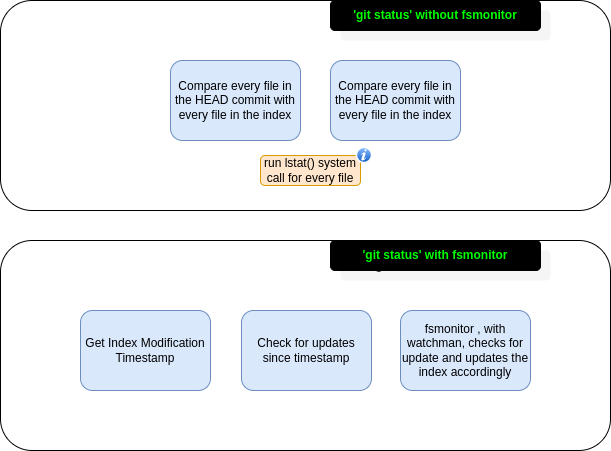

2. Включить `feature.manyFile` с помощью `git config feature.manyFiles true`. Это делает две вещи:

  1. Устанавливает `index.version = 4`, что включает сжатие префиксов путей в индексе
  2. Устанавливает `core.untrackedCache=true`, который по умолчанию имеет значение `keep`. Кэш неотслеживаемых файлов (untracked cache) — довольно важное понятие. Он записывает mtime всех файлов и каталогов в рабочем каталоге. Так, когда приходит время перебрать все файлы и каталоги, можно пропустить те, у которых mtime не обновлялся.

Перед включением можно выполнить `git update-index --test-untracked-cache`, чтобы проверить его и убедиться, что mtime в системе работает.

3. В Git также есть встроенная команда `git-maintainence`, которая оптимизирует репозиторий Git, чтобы такие команды, как `git add` или `git fatch`, выполнялись быстрее, а репозиторий занимал меньше места на диске. Эту команду рекомендуется запускать периодически (например, каждый день).

4. Отслеживать только то, что используют/изменяют разработчики: некоторые репозитории могут содержать сгенерированные файлы, которые нужны для правильной работы проекта (или для поддержки определённых возможностей доступности), но на самом деле никак не изменяются разработчиками. В этом случае отслеживать их бессмысленно.
Чтобы не заполнять этими файлами рабочий каталог, можно использовать функцию Git `sparse checkout`.

5. Наконец, с некоторыми системами сборки можно точно знать, какие файлы используются/актуальны, исходя из компонента проекта, над которым работает разработчик. Это вместе с `sparse checkout` может привести к ситуации, когда в рабочем каталоге оказывается лишь небольшое подмножество файлов. Благодаря этому такие команды, как `git add`, `git status` и т.д., выполняются действительно быстро

### Типовые системы

В этом разделе рассматривается проектирование различных типов приложений. Ничего слишком специфичного, но такие типы приложений довольно распространены в реальном мире.

Для каждого типа приложения будут указаны:

  * Требования
  * API endpoints (публичные и внутренние)

#### Система оплаты и бронирования для парковочных гаражей

Спроектируйте систему оплаты и бронирования для парковочных гаражей, которая поддерживает три типа транспортных средств:

  * обычные
  * крупные
  * компактные

С фиксированным тарифом в зависимости от типа транспортного средства и времени

Примечание: если нужно спроектировать такую систему без каких-либо других требований, о тарифах и специальных парковочных местах стоит спросить.

##### Система оплаты и бронирования для парковочных гаражей - уточнения

Задайте уточняющие вопросы, например:

  * Кто пользователи и как они будут пользоваться системой?
  * Какие входные и выходные данные должна поддерживать система?
  * Какой объём данных должна обрабатывать система?
    * Сколько запросов в секунду?

##### Система оплаты и бронирования для парковочных гаражей - требования

* Пользователь может забронировать парковочное место и получить билет
* Пользователь не может забронировать место, уже забронированное кем-то другим
* Система поддерживает следующие типы транспортных средств: обычные, крупные и компактные
* Система поддерживает фиксированный тариф в зависимости от типа транспортного средства и времени, проведённого им на парковке

##### Система оплаты и бронирования для парковочных гаражей - API (публичные endpoints)

* `/reserve`
  * Параметры: garage_id, start_time, end_time
  * Возвращает: (spot_id, reservation_id)

* `/cancel`
  * Параметры: reservation_id

* `/payment`
  * Параметры: reservation_id
  * Использовать существующие API, например Squre, PayPal, Stripe и т.д.

##### Система оплаты и бронирования для парковочных гаражей - API (внутренние endpoints)

* `/calculate_payment` - рассчитать оплату за бронирование парковочного места
  * Параметры: reservation_id

* `/free_spots` - получить свободные места, где может припарковаться автомобиль (примечание: маленький автомобиль может припарковаться на месте для большого)
  * Параметры: garage_id, vehicle_type, time

* `/allocate_spot` - выполнить само бронирование парковочного места
  * Параметры: garage_id, vehicle_type, time

* `/create_account` - возможность создать учётную запись, чтобы пользователи могли пользоваться приложением и бронировать парковочные места
  * Параметры: email, username, first_name (необязательно), last_name (необязательно), password (необязательно)

* `/login`
  * Параметры: email, username (необязательно), password

##### Система оплаты и бронирования для парковочных гаражей - масштаб

Можно предположить, что количество пользователей ограничено количеством парковочных мест в каждом гараже с учётом, конечно, количества гаражей. 
С учётом этого масштаб пользователей вполне предсказуем и не может достичь неожиданных значений (при условии, что новые гаражи не добавляются или добавляются с постоянной скоростью)

##### Система оплаты и бронирования для парковочных гаражей - схема данных

База данных на основе SQL со следующими таблицами

Reservations

| Поле        | Тип                 |
| ----------- | --------------------|
| id          | primary key, serial |
| start       | timestamp           |
| end         | timestamp           |
| paid        | boolean             |

Garages

| Поле         | Тип                 |
| ------------ | --------------------|
| id           | primary key, serial |
| zipcode      | varchar             |
| rate_compact | decimal             |
| rate_compact | decimal             |
| rate_regular | decimal             |
| rate_large   | decimal             |

Spots

| Поле         | Тип                 |
| ------------ | --------------------|
| id           | primary key, serial |
| garage_id    | foreign_key, int    |
| vehicle_type | enum                |
| status       | enum                |

Users

| Поле         | Тип                 |
| ------------ | --------------------|
| id           | primary key, serial |
| email        | varchar (SHA-256)   |
| first_name   | varchar             |
| last_name    | varchar             |

Vehicles

| Поле         | Тип                 |
| ------------ | --------------------|
| id           | primary key, serial |
| license      | varchar             |
| type         | enum                |

##### Система оплаты и бронирования для парковочных гаражей - высокоуровневая архитектура

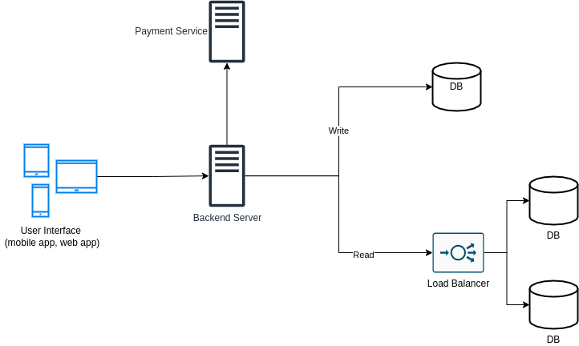

### Реальные системы

В этом разделе рассматривается проектирование реальных приложений.

Каждый подраздел здесь содержит полное описание системы. В процессе обучения рекомендуется НЕ смотреть на это полное описание, а начать с попытки разобраться самостоятельно. Точнее, для каждой системы:

  * Составить список её функциональных требований и возможностей
  * Составить список её нефункциональных требований
  * Спроектировать спецификацию API
  * Выполнить высокоуровневое проектирование
  * Выполнить детальное проектирование

#### WhatsApp

##### Возможности / функциональные требования

  * Обмен сообщениями с отдельными людьми и группами (отправка и получение)
  * Обмен документами, изображениями, видео
  * Статус пользователя: в сети, был в сети и т.д.
  * Статус сообщения: доставлено, прочитано (и кем прочитано)
  * Шифрование: сквозное (end-to-end) шифрование общения

##### Нефункциональные требования

  * Масштаб
  * Минимальная задержка
  * Высокая доступность
  * Согласованность
  * Долговечность

##### Спецификация API

Обмен сообщениями:

  * Сессия личного чата
    * Вход: API key, ID пользователя, ID пользователя (получателя)
  * Отправка сообщения
    * Вход: API key, ID сессии, тип сообщения, сообщение

Учётная запись пользователя:

  * Регистрация учётной записи
    * Вход: API key, данные пользователя
  * Подтверждение учётной записи
    * Вход: API key, ID пользователя, код подтверждения

##### Обзор архитектуры системы

TODO

##### Компоненты архитектуры системы

TODO

#### Amazon Video Prime

##### Возможности / функциональные требования

* Учётные записи
  * У пользователей есть учётная запись (они могут входить в неё и выходить из неё)
* Загрузка видео
  * Поддержка загрузки видео (и миниатюр видео) создателями/продюсерами контента
  * Загружать видео могут только определённые учётные записи, а не все
  * Ограничения на загрузку
    * Длительность видео (например, 5 часов)
    * Размер на час видео (если 5 часов и 1 ГБ на час = 5 ГБ)
    * Размер миниатюры (например, 50 МБ)
* Потоковое воспроизведение видео
  * Пользователи могут смотреть видео в потоковом режиме на разных устройствах
    * Интерфейс различается в зависимости от устройства
  * Буферизация (в ущерб качеству) (**Примечание**: это компромисс)
    * Хранить версии одного и того же видео в разном качестве
* Просмотр каталога видео
  * Возможность помечать видео тегами (жанр, дата, ...)
  * Возможность для пользователей искать видео (по названию, тегу, ...)

##### Нефункциональные требования

  * Надёжность (надёжное хранилище для хранения загруженных видео и их потоковой передачи по требованию)
  * Масштабируемость (возможность подключать новых пользователей без проблем с производительностью)
  * Высокая доступность (если один из компонентов откажет, системой всё равно можно будет пользоваться)

## Процесс проектирования системы

Как выполнять проектирование системы?
TODO(abregman): этот раздел ещё не готов

1. Чётко определить требования: если требования неясны, обязательно уточнить их
2. Ответить на вопрос, каков прогнозируемый трафик?
3. Определить, какие атрибуты качества важны для системы: масштабируемость, эффективность, надёжность и т.д.
4. TODO

## Советы для собеседования по проектированию систем

Если вы здесь, потому что предстоит собеседование по проектированию систем, вот пара советов:

* Выбирать самую простую архитектуру, которая удовлетворяет требованиям к системе (функциональным требованиям, а также, например, ожидаемому трафику). Не нужно всё усложнять :)

Более конкретные советы в зависимости от этапа собеседования:

### Что спросить у себя, увидев задачу на проектирование системы

Примечание: эти вопросы стоит задать себе и после того, как проектирование системы выполнено

* Масштабируется ли система, если добавить больше пользователей?
* Есть ли в архитектуре единая точка отказа?
* Не стесняться просить уточнений по заданной задаче проектирования. Некоторые задачи на проектирование систем намеренно сформулированы расплывчато

### Что спросить у интервьюера

* Каковы требования?
  * Как используется система?
  * Сколько пользователей, как ожидается, будут обращаться к системе?
  * Как часто пользователи обращаются к системе?
  * Откуда пользователи обращаются к системе?
* Есть ли какие-либо ограничения?
* При необходимости просить уточнений. Иногда инструкции или требования намеренно расплывчаты.

#### Что сказать в начале обсуждения проектирования системы

* Перечислить необходимые возможности системы
* Назвать проблемы, с которыми ожидается столкнуться
* Назвать трафик, который, как ожидается, должна обрабатывать система

### Что стоит озвучивать во время проектирования или обсуждения

* При каждом решении, принятом в ходе проектирования системы, называть минусы и плюсы такого решения

## Благодарности

Баннер проекта, иконки, используемые в разделе упражнений «Общие», и указатель тем по проектированию систем созданы Arie Bregman

## Участие

Если хотите внести вклад в проект, прочитайте [руководство для участников](CONTRIBUTING.md)

## Лицензия

