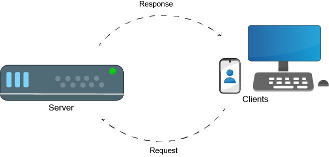

# Базовая архитектура

- [Базовая архитектура](#базовая-архитектура)
  - [Клиент](#клиент)
  - [Сервер](#сервер)
    - [Что такое сервер?](#что-такое-сервер)
    - [Типы серверов](#типы-серверов)
  - [Клиенты и серверы](#клиенты-и-серверы)

## Клиент

Клиент — это программное или аппаратное обеспечение, которое обращается к ресурсу или сервису, предоставляемому сервером.
Хотя в некоторых случаях сервер и клиент могут находиться в одной системе/на одном хосте, в большинстве случаев они находятся в разных системах.

Примеры клиентов:

* Веб-браузер, с помощью которого пользователь открывает определённую веб-страницу
* Мобильный телефон, с помощью которого пользователь читает электронную почту

## Сервер

### Что такое сервер?
Сервер, как и клиент, может быть программным или аппаратным обеспечением, но, в отличие от клиента, его роль — обслуживать клиента. Это может быть предоставление клиенту определённого ресурса или возможности пользоваться сервисом, работающим на сервере.
Несколько примеров:

* Система, которая хранит файлы и позволяет пользователю получать к ним доступ или скачивать их
* Система, на которой работает сервис, позволяющий пользователям слушать музыку

### Типы серверов

* Bare Metal: физические серверы. Реальное оборудование. Часто выделяется одному клиенту, проекту и т.п. и не используется совместно, как в случае серверов для виртуализации и облака
 
* Виртуальные: серверы, развёрнутые поверх платформы виртуализации или в облаке (например, в таких облаках, как GCP, AWS и Azure)

## Клиенты и серверы

Теперь, когда понятно, что такое сервер и что такое клиент, ясна и связь между ними: клиент отправляет запросы (или ответы) серверу, а сервер отвечает клиенту в соответствии с его запросом.

 

