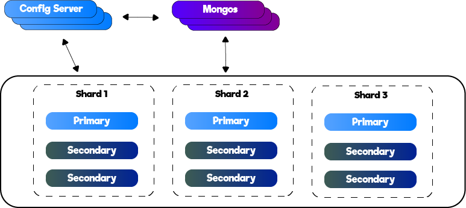
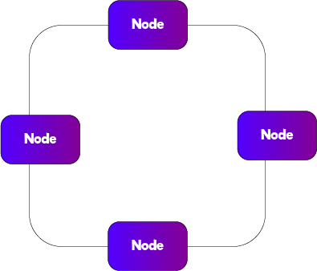
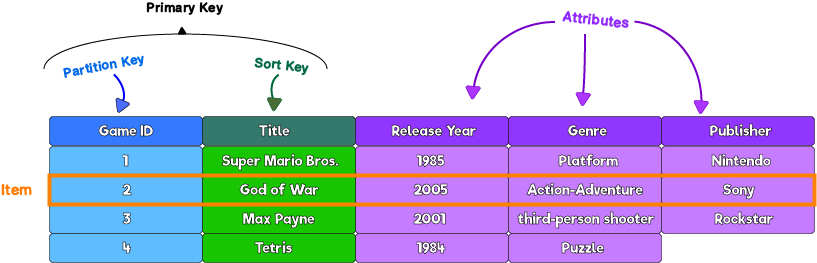
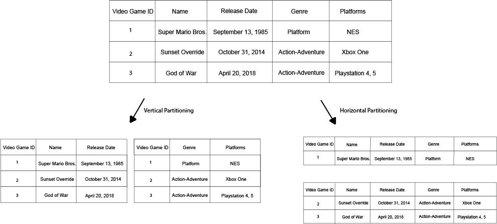
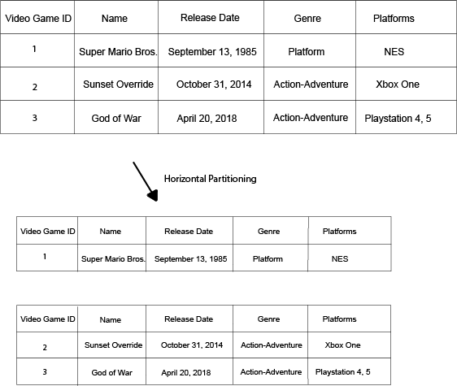
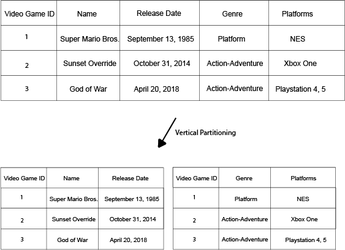
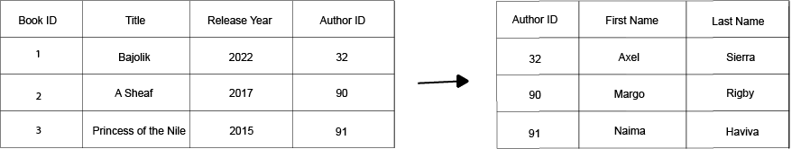
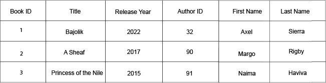

# Базы данных

- [Базы данных](#базы-данных)
  - [Что такое база данных?](#что-такое-база-данных)
  - [Типы](#типы)
    - [SQL](#sql)
    - [NoSQL](#nosql)
      - [MongoDB](#mongodb)
      - [Cassandra](#cassandra)
      - [AWS DynamoDB](#aws-dynamodb)
      - [Redis](#redis)
  - [Большие данные](#большие-данные)
    - [Озеро данных](#озеро-данных)
  - [Репликация](#репликация)
  - [Партиционирование](#партиционирование)
    - [Горизонтальное партиционирование](#горизонтальное-партиционирование)
    - [Вертикальное партиционирование](#вертикальное-партиционирование)
  - [Соответствие ACID](#соответствие-acid)
    - [Атомарность](#атомарность)
    - [Согласованность](#согласованность)
    - [Изолированность](#изолированность)
    - [Долговечность](#долговечность)
  - [Нормализация](#нормализация)
    - [Нормализованные данные](#нормализованные-данные)
    - [Денормализованные данные](#денормализованные-данные)
    - [Теорема CAP](#теорема-cap)
  - [Вопросы](#вопросы)

## Что такое база данных?

[Wikipedia](https://en.wikipedia.org/wiki/Database): «база данных — это организованная совокупность данных, которые хранятся в компьютерной системе и к которым осуществляется электронный доступ.»

Пожалуй, самый простой пример базы данных — файл в файловой системе. Такой файл может хранить информацию о людях и их адресах, о сортах вина или любые другие упорядоченные данные.

Хотя файл можно считать базой данных, в архитектурах систем он не используется. Современные базы данных — это полноценные функциональные сервисы, которые умеют гораздо больше, чем просто хранить данные.

## Типы

### SQL

### NoSQL

NoSQL не используют традиционные табличные связи, как SQL-базы данных. Их также называют «шардированными базами данных» (Sharded Databases), поскольку информация в них [горизонтально партиционирована](#горизонтальное-партиционирование).

Одна из сложностей таких баз данных — операция решардинга (resharding): как добавлять или удалять шарды в зависимости от необходимого масштабирования?
Другая сложность — так называемые «горячие точки» (hotspots): что делать с шардами/партициями, которые популярнее других? Иными словами, как учитывать трафик/популярность при партиционировании?

Рассмотрим несколько примеров таких баз данных

#### MongoDB

#### Cassandra

NoSQL база данных. Её архитектура показана на схеме ниже. Каждый узел может выступать основным интерфейсом, поэтому доступность в архитектуре Cassandra высокая

Хотя доступность в Cassandra может быть лучше, чем в других базах данных, поскольку каждый узел может быть основным интерфейсом, узлы нужно постоянно синхронизировать, поэтому согласованность здесь не на высоте.

#### AWS DynamoDB

TODO

#### Redis

Redis — это база данных в оперативной памяти (in-memory). Поэтому она считается очень быстрой. Данные в Redis хранятся в виде пар ключ-значение.

Она идеальна для сценариев, где нужно часто читать из БД или писать в неё, особенно в системах реального времени, где не хочется зависеть от ввода-вывода дисков, который считается более медленным (~100 мкс для SSD против ~100 нс для RAM).

Кроме того, Redis однопоточна. Может возникнуть вопрос, как это работает, ведь на такую базу данных может приходить множество входящих запросов и исходящих ответов, — почему поток не блокируется в ожидании завершения? Ответ — мультиплексирование ввода-вывода (I/O multiplexing): ОС позволяет одному потоку ожидать на множестве соединений одновременно.

## Большие данные

### Озеро данных

Озеро данных (Data Lake) — это подход, при котором данные просто организуются в текстовых файлах (json, csv и т.д.) и хранятся в системе хранения (например, S3, Blob Storage и т.д.)

Данные в озёрах данных часто неструктурированы, и обычно есть отдельный процесс/сервис для создания схемы этих данных (например, в AWS это Amazon Glue)

## Репликация

[Wikipedia](https://en.wikipedia.org/wiki/Replication_(computing)): «Репликация в вычислительной технике — это совместное использование информации для обеспечения согласованности между избыточными ресурсами, такими как программные или аппаратные компоненты, с целью повышения надёжности, отказоустойчивости или доступности.»

Во многих архитектурах систем довольно часто встречается отдельный экземпляр для записи и другой экземпляр для чтения. Дело в том, что при разделении на экземпляры для чтения и записи нужно обеспечить согласованность данных. Здесь и становится актуальной репликация.

## Партиционирование

Способы разделения таблиц БД на дополнительные таблицы

### Горизонтальное партиционирование

Разделение таблицы на несколько таблиц. Физически она разделена, но логически рассматривается как одна таблица.

В качестве примера возьмём базу данных видеоигр. Можно завести отдельную базу данных для каждого жанра видеоигр или для каждой компании-разработчика, но в итоге все они рассматриваются как база данных «видеоигры», поэтому у каждой таблицы одни и те же столбцы.

Подведём итог:
* Таблица делится на несколько таблиц с разными строками
* У каждой таблицы одни и те же столбцы, но разные строки
* Горизонтальную партицию также называют шардом (Shard).

### Вертикальное партиционирование

Как и при горизонтальном партиционировании, таблица делится на таблицы. Разница в том, что при вертикальном партиционировании у каждой таблицы меньше столбцов (тогда как при горизонтальном партиционировании количество столбцов в каждой отдельной таблице одинаково)

Подведём итог:
* Таблица делится на несколько таблиц с разными столбцами
* У таблиц разные столбцы

## Соответствие ACID

Соответствие ACID (ACID Compliance) — это набор свойств/принципов базы данных, гарантирующих согласованность и корректность данных.

### Атомарность 

Правило атомарности (atomicity) определяет, что транзакция либо целиком выполняется успешно, либо целиком завершается неудачей.
Например, если добавляются данные, то они либо добавлены полностью, либо не добавлены вовсе — частичного добавления данных не бывает. Иными словами, операция либо выполняется целиком один раз, либо не происходит вовсе.

### Согласованность 

Согласованность (consistency) означает, что всё, что записано в базу данных, будет возвращено, если через мгновение после записи выполнить операцию чтения.

### Изолированность

Одна транзакция не помешает другой транзакции, и другая транзакция ни в коем случае не будет затронута ею.

### Долговечность

После завершения транзакции данные остаются в базе данных, что бы ни произошло дальше (кроме, конечно, операции удаления). Так что если, например, база данных выключается, перезагружается, обновляется и т.п., данные остаются как есть.

## Нормализация
### Нормализованные данные

Данные разбиты на несколько таблиц, и чтобы получить полные данные, нужно выполнять соединения (joins) разных таблиц.

Так работают реляционные базы данных: между разными таблицами есть связи, и для получения полного набора данных выполняются поиски (lookups) и соединения.

На изображении ниже показан пример нормализованных данных

Преимущества:

* Обновления выполняются в одном месте, так как для каждого вида данных есть отдельная таблица.

Недостатки:

* Чтобы получить данные, иногда приходится выполнять несколько поисков

### Денормализованные данные

Вся информация хранится в одном месте, как видно на изображении ниже

Преимущества:

* Один поиск/запрос, чтобы получить всю информацию о конкретной записи

Недостатки:

* Чтобы обновить информацию, придётся просканировать все записи/строки 

### Теорема CAP

Согласно теореме CAP (также известной как теорема Брюера) любая распределённая БД в любой момент времени может обеспечить только два из следующих трёх свойств:

* Согласованность (Consistency): на любой запрос чтения возвращается результат самой последней записи
* Доступность (Availability): БД высокодоступна, поэтому на любой запрос приходит ответ
* Устойчивость к разделению (Partition Tolerance): продолжит ли система работать в случае сетевой проблемы? Может ли база данных масштабироваться горизонтально?

Со временем теорема CAP стала довольно слабой, так как большинство современных баз данных на деле довольно хорошо справляются со всеми этими аспектами.
## Вопросы

Каковы преимущества репликации базы данных?
 <b>

* Обеспечение высокой доступности: при создании реплики фактически появляется ещё один источник данных, который можно использовать, даже когда исходный экземпляр недоступен
* Лучшее распределение производительности: можно решить, что один из экземпляров используется для чтения, а другой — для записи
* Приложение становится надёжнее: даже если база данных недоступна, можно использовать реплику
</b>

Объясните, что такое горизонтальное партиционирование
 <b>

Читайте [здесь](#горизонтальное-партиционирование)
</b>

Объясните, что такое вертикальное партиционирование
 <b>

Читайте [здесь](#вертикальное-партиционирование)
</b>

Что такое шард (Shard)?
 <b>

Другое название [горизонтального партиционирования](#горизонтальное-партиционирование), при котором одна таблица превращается в несколько меньших таблиц.
</b>

Опишите архитектуру одной распространённой базы данных
 <b>

На этой странице упоминается пара таких:

* [MongoDB](#mongodb)
* [Cassandra](#cassandra)
</b>

Что такое решардинг (Resharding)?
 <b>
</b>

Что такое денормализованные данные? Объясните преимущества и недостатки денормализованных данных
 <b>
</b>

Что такое нормализованные данные? Объясните преимущества и недостатки нормализованных данных
 <b>
</b>

Когда стоит выбрать подход с нормализованными данными вместо подхода с денормализованными данными?
 <b>

На этот вопрос не всегда есть однозначный ответ. Многое зависит от опыта пользователей или клиентов и от запросов, которые будут выполняться к базе данных.

Например, если обновления нужно выполнять довольно часто и для разных столбцов или вложенных документов, нормализованные данные могут оказаться лучшим подходом.

Если же речь в основном о поиске, то в этом случае лучше могут подойти денормализованные данные. Но, опять же, всё зависит от конкретного сценария.
</b>

Что такое озеро данных (data lake)?
 <b>
</b>

Что можно сказать о базах данных в оперативной памяти по сравнению с дисковыми с точки зрения реализации кода?
 <b>

Базы данных в оперативной памяти обычно проще реализовать или, по крайней мере, они менее сложны, так как при записи на диск и чтении с него приходится выполнять довольно много операций (открытие файла, выделение буфера, закрытие файла и т.д.)
</b>

Как, глядя на данные в базе данных, понять, что они были добавлены полностью, а не частично? Иными словами, как узнать, что транзакция записи в базу данных завершилась успешно?
 <b>

Благодаря атомарности в [соответствии ACID](#соответствие-acid).
</b>

Объясните теорему CAP
 <b>
</b>

Как выбрать базу данных?
 <b>

Сузить выбор могут помочь следующие вопросы:

* Тип данных, которые нужно хранить (текст, изображения, ...)
* Что важно? Например: согласованность, доступность, ... в целом неплохо попробовать применить теорему CAP
* Шаблоны доступа: данные в основном читаются? записываются? трафик стабильный? непредсказуемый трафик с пиками?
</b>

Примените теорему CAP к некоторым современным базам данных
 <b>

* Cassandra: есть доступность (узлов несколько) и устойчивость к разделению, но нет согласованности, так как в Cassandra нет единственного главного узла (master), и данные нужно синхронизировать между всеми узлами, чтобы чтение всегда давало одинаковый результат, независимо от того, к какому узлу обращаться

* MongoDB: обладает устойчивостью к разделению, так как масштабируется горизонтально и имеет несколько шардов. Она также согласованна, так как у неё единственный главный узел. Но поскольку это архитектура с единственным главным узлом, доступности нет. Есть единая точка отказа (да, даже если есть дополнительные серверы и резервные копии, так как в момент отказа придётся восстанавливать и синхронизировать данные).
</b>
