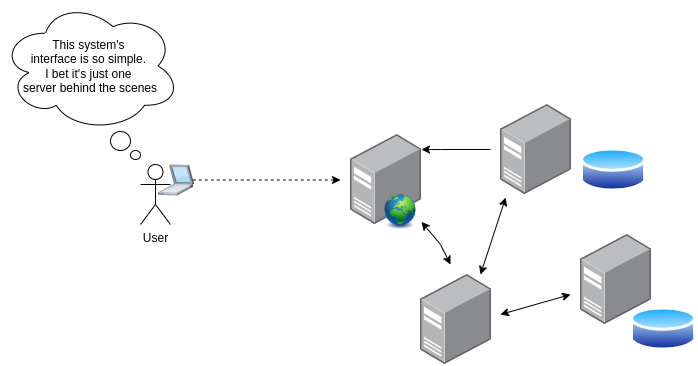
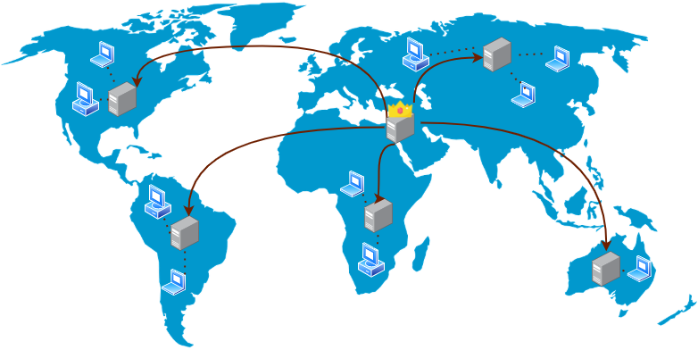

# Распределённые системы

- [Распределённые системы](#распределённые-системы)
  - [Что такое распределённая система?](#что-такое-распределённая-система)
  - [Заблуждения о распределённых системах](#заблуждения-о-распределённых-системах)
  - [Дрейф часов](#дрейф-часов)
  - [CDN](#cdn)

## Что такое распределённая система?

* Группа компьютеров/серверов, работающих совместно
* Сложность распределённой системы обычно скрыта от пользователя

## Заблуждения о распределённых системах

Существует ряд проблем, с которыми приходится сталкиваться при проектировании и управлении распределёнными/высоконагруженными системами, но в гораздо меньшей степени — с нераспределёнными системами:

* Надёжность сети: когда система работает на одном хосте, сеть не так важна, как когда нужно управлять десятками или сотнями (и более) узлов
* Нулевая задержка: при работе на одном хосте задержка не проблема, но при управлении множеством хостов возникает вопрос, как удержать задержку как можно ближе к нулю?
* Пропускная способность: как и с задержкой, при работе на одном хосте пропускная способность бесконечна, но когда система распределена, данные приходится перемещать между серверами, и пропускная способность становится проблемой 
* Постоянно меняющаяся топология: в распределённой системе хосты и различные компоненты могут отключаться и включаться, то есть топология постоянно меняется, тогда как один хост неизменен
* Безопасность: защитить один хост намного проще, чем распределённую систему, где нужно защищать не только все компоненты, но и взаимодействие между различными хостами и компонентами
* Размер команды: для управления одним хостом нужно меньше администраторов, чем для управления распределённой системой с сотнями, тысячами или даже большим количеством хостов и компонентов

## Дрейф часов

[Wikipedia](https://en.wikipedia.org/wiki/Clock_drift): «Дрейф часов (clock drift) — это ряд связанных явлений, при которых часы идут не точно с той же скоростью, что и эталонные часы. То есть через некоторое время часы „расходятся“ или постепенно рассинхронизируются с другими часами»

Синхронизация часов — сложная задача в распределённых системах, потому что у каждой системы свои часы, и если часы системы начинают дрейфовать, это может повлиять на систему в целом и привести к непредвиденному поведению.

## CDN

[Cloudflare](https://www.cloudflare.com/en-gb/learning/cdn/what-is-a-cdn): «Сеть доставки контента (CDN) — это географически распределённая группа серверов, которые работают совместно, чтобы обеспечить быструю доставку интернет-контента.»

Иными словами, сеть доставки контента позволяет быстро передавать контент благодаря серверам с этим контентом, расположенным по всему миру или в определённом регионе. Клиент обращается к этим серверам, а не к основному серверу, на котором изначально находятся данные.

