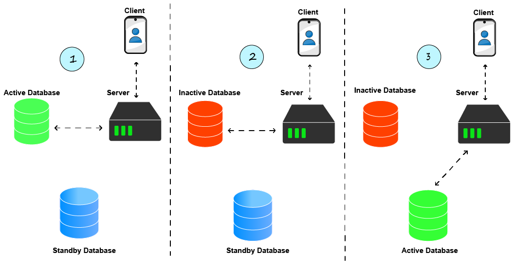
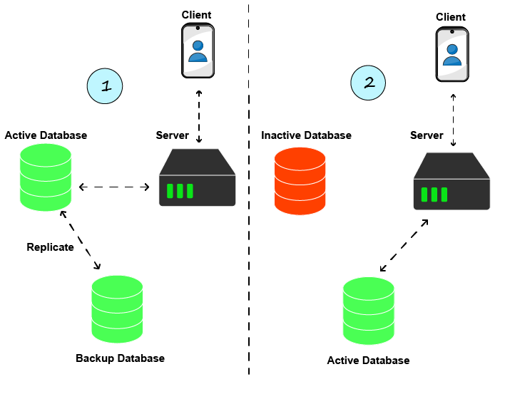
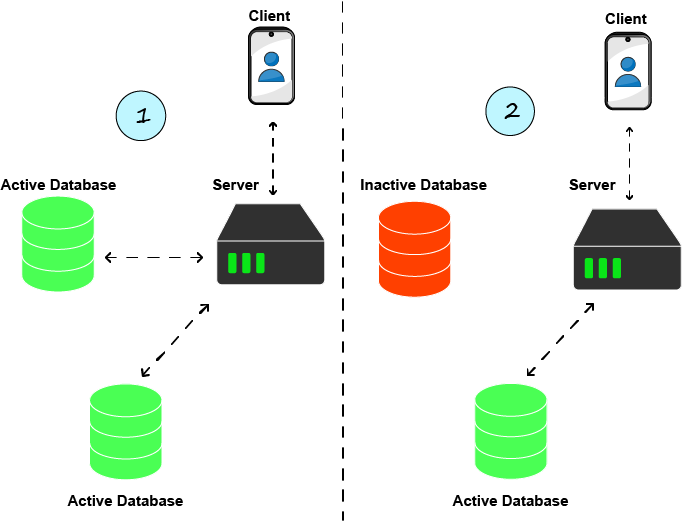

- [Надёжность](#надёжность)
- [Обслуживаемость](#обслуживаемость)
- [Доступность](#доступность)
- [Failover](#failover)
    - [Cold Standby](#cold-standby)
      - [Преимущества](#преимущества)
      - [Недостатки](#недостатки)
    - [Сценарии использования](#сценарии-использования)
    - [Warm Standby](#warm-standby)
      - [Преимущества](#преимущества-1)
      - [Недостатки](#недостатки-1)
    - [Hot Standby](#hot-standby)
      - [Преимущества](#преимущества-2)
      - [Недостатки](#недостатки-2)
- [Вопросы](#вопросы)
  - [Failover](#failover-1)
# Надёжность

[Wikipedia](https://en.wikipedia.org/wiki/Reliability,_availability_and_serviceability): «Надёжность (reliability) можно определить как вероятность того, что система будет выдавать правильные результаты до некоторого заданного момента времени t.[5] Надёжность повышается за счёт функций, помогающих избегать, обнаруживать и устранять аппаратные сбои. Надёжная система не продолжает молча работать и не выдаёт результаты, содержащие неисправленные повреждённые данные.»

Вопрос: в чём разница между доступностью (Availability) и надёжностью (Reliability)?

# Обслуживаемость

[Wikipedia](https://en.wikipedia.org/wiki/Reliability,_availability_and_serviceability): «Обслуживаемость (serviceability), или ремонтопригодность (maintainability), — это простота и скорость, с которой систему можно отремонтировать или обслужить; если время восстановления отказавшей системы увеличивается, доступность снижается.»

# Доступность

[Wikipedia](https://en.wikipedia.org/wiki/Reliability,_availability_and_serviceability): «Доступность (availability) — это вероятность того, что система работоспособна в заданный момент времени, т.е. время, в течение которого устройство фактически работает, в процентах от общего времени, в течение которого оно должно работать. Системы высокой доступности могут указывать доступность в минутах или часах простоя в год.»

Проще говоря, это процент времени, в течение которого система, сервис или приложение доступны и работоспособны

# Failover

Failover (или стратегия failover) — это процесс переключения при сбое с неработоспособной системы (приложения, хранилища, БД, ...) на работоспособную систему или на предыдущее работоспособное состояние той же системы.

Раньше это делалось автоматически или вручную. Сегодня, особенно в эпоху публичных облаков, этот процесс часто автоматизирован.

### Cold Standby

При Cold Standby («холодный резерв») переход на резервный сервис происходит только после того, как активный сервис становится неработоспособным. Процесс показан на изображении ниже на примере базы данных:

1. Сервер работает с активной базой данных
2. База данных по разным причинам становится неработоспособной
3. Происходит переключение на резервную базу данных. Важно отметить, что это переключение может быть небыстрым. Оно может включать процесс восстановления данных и обязательно включает перенаправление трафика на новую базу данных вместо прежней

#### Преимущества

* Дёшево по сравнению с другими современными вариантами failover
На этом, в общем-то, всё. Кто-то скажет, что это ещё и просто, но лично я бы сказал, что это зависит от случая.
#### Недостатки

* Есть простой. Пользователи столкнутся с неработающим сервисом, так как активной базы данных нет, пока не произойдёт переключение на резервную. Это может быть быстро, но может и занять время — в случае баз данных это зависит от объёма данных.
* Весь трафик, пришедший во время простоя, и все данные, которые пользователь хотел сохранить в БД, теряются.

### Сценарии использования

* Некритичные сервисы и проекты, которые могут выдержать простой в пару часов и ищут дешёвое решение для failover

### Warm Standby

В Cold Standby описана ситуация, когда резервная база данных используется только при сбое, и сначала может потребоваться восстановление данных. Warm Standby («тёплый резерв») отличается тем, что резервная база данных постоянно синхронизируется с рабочей (production) базой данных.

Сам сервер не взаимодействует с резервной базой данных, но она активна, поскольку рабочая база данных реплицирует в неё данные.

#### Преимущества

* В основном просто. В случае баз данных большинство современных баз данных умеют реплицироваться с помощью простого изменения конфигурации

#### Недостатки

* Есть простой. Всё далеко не так плохо, как в случае Cold Standby, но данные всё же могут быть потеряны, а у пользователей будет плохой опыт, пусть и недолго

### Hot Standby

Одновременное взаимодействие с двумя или более экземплярами. В случае баз данных сервер будет читать и писать в обе. Это означает, что если одна из них недоступна, пользователь не заметит простоя, так как сервер по-прежнему взаимодействует с одной из баз данных, содержащей те же данные, что и другой экземпляр.

По сути, другое название hot standby («горячий резерв») — горизонтальное масштабирование.

#### Преимущества

* Нулевой простой. Даже если одна база данных выходит из строя, можно использовать другую, а сервер уже взаимодействует с ней, так что пользователи никакого простоя не заметят.

#### Недостатки

* Может быть довольно дорого, особенно по сравнению с другими стратегиями, такими как cold и warm standby

# Вопросы
## Failover

Объясните, что такое «Failover». Когда он происходит?
 <b>
</b>

Объясните стратегию failover «Cold Standby» (включая плюсы и минусы)
 <b>
</b>

В каких ситуациях стоит использовать «Cold Standby»?
 <b>
</b>

Объясните стратегию failover «Warm Standby» (включая плюсы и минусы)
 <b>
</b>

Объясните стратегию failover «Hot Standby» (включая плюсы и минусы)
 <b>
</b>
