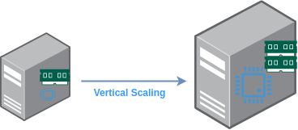
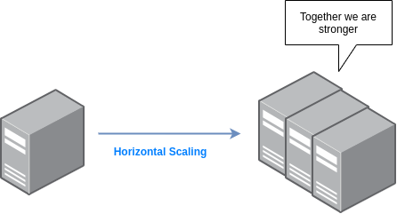

# Масштабируемость

- [Масштабируемость](#масштабируемость)
  - [Вертикальное масштабирование](#вертикальное-масштабирование)
    - [Сценарии использования](#сценарии-использования)
    - [Ограничения](#ограничения)
  - [Горизонтальное масштабирование](#горизонтальное-масштабирование)
  - [Коэффициент масштабируемости](#коэффициент-масштабируемости)
    - [Линейная масштабируемость](#линейная-масштабируемость)
    - [Сублинейная масштабируемость](#сублинейная-масштабируемость)
    - [Сверхлинейная масштабируемость](#сверхлинейная-масштабируемость)
    - [Отрицательная масштабируемость](#отрицательная-масштабируемость)
  - [Вопросы](#вопросы)

[Wikipedia](https://en.wikipedia.org/wiki/Scalability): «Масштабируемость — это свойство системы справляться с растущим объёмом работы за счёт добавления в систему ресурсов»

Проще говоря, масштабируемость — это ответ на вопрос, способны ли система или архитектура масштабироваться так, чтобы соответствовать новым нагрузкам и потребностям. 
На практике это ответы на такие вопросы:
  * если в системе работает база данных, сможет ли она обрабатывать больше запросов?
  * если в системе работает сервис, транслирующий видео миллионам пользователей, сможет ли он транслировать их так же, если количество пользователей утроится?

Кроме того, масштабирование может выполняться для разных компонентов. Например, в большинстве облачных сред масштабирование поддерживается для:

  * Виртуальных машин
  * Виртуальных сетевых функций
  * Контейнеров

Существуют разные способы масштабирования.

## Вертикальное масштабирование

Вертикальное масштабирование — это добавление дополнительных ресурсов *в существующую систему/компонент/узел*. Например, если есть сервер, вертикальное масштабирование может выполняться одним или несколькими из следующих способов:

  * Добавить серверу оперативной памяти
  * Добавить хранилища/дисков
  * Добавить процессоров

### Сценарии использования

Если нужно простое изменение, не требующее добавления новых компонентов в архитектуру, и у приложения/системы низкий трафик, вертикальное масштабирование может быть отличным вариантом

### Ограничения

Ограничение вертикального масштабирования очевидно: масштабироваться можно до тех пор, пока физически или виртуально возможно увеличивать ресурсы машины.

## Горизонтальное масштабирование

Добавление новых систем/узлов/компонентов, но при этом так, чтобы они работали вместе и клиенту казалось, что он взаимодействует с одной системой. 
Несколько примеров:

 * Вместо одного веб-сервера — два веб-сервера и один балансировщик нагрузки, распределяющий трафик между ними
 * Вместо одного сервера баз данных — две базы данных

Над чем подумать: теперь, когда известно о вертикальном и горизонтальном масштабировании, какое из них выбрать, если можно выполнить только одно?

## Коэффициент масштабируемости

Когда ресурсы системы (или архитектуры) удваиваются, можно ожидать, что система сможет справляться и с удвоенной нагрузкой, верно? Но так происходит не обязательно. Коэффициент масштабируемости (scalability factor) — это термин, описывающий нагрузку, с которой система способна справиться в результате масштабирования ресурсов.

### Линейная масштабируемость

Линейная масштабируемость имеет место, когда нагрузка, с которой справляется система, растёт пропорционально росту ресурсов. Коэффициент масштабируемости при масштабировании остаётся постоянным. 
Например, ресурсы системы утроены -> система способна справляться с утроенной нагрузкой. В реальности чаще всего это не так.

### Сублинейная масштабируемость

Более реалистичный результат масштабирования систем — некоторые ресурсы или компоненты масштабируются не так, как ожидалось (или не так, как другие ресурсы и компоненты). Поэтому удвоение ресурсов на деле даёт улучшение обработки нагрузки лишь в 1,5 раза. В этом случае коэффициент масштабируемости меньше 1.0

### Сверхлинейная масштабируемость

Это оптимальный результат. Например, обработка нагрузки утраивается при «всего лишь» удвоении ресурсов. Иными словами, относительное изменение производительности больше относительного изменения масштаба (например, добавления процессоров). Коэффициент масштабируемости в этом случае больше 1.0

### Отрицательная масштабируемость

Это может прозвучать безумно, но в некоторых случаях масштабирование системы на деле приводит к худшим результатам, и именно это называется отрицательной масштабируемостью. Коэффициент масштабируемости меньше 0.

## Вопросы

Объясните, что такое масштабируемость
 <b>
</b>

Объясните, что такое «вертикальное масштабирование», и приведите пример, когда оно помогает решить проблему
 <b>

Вертикальное масштабирование — это добавление

Например, есть веб-сайт, который обслуживает класс из 20 студентов. Внезапно приходится вести несколько классов, и сайт должен обслуживать 40 студентов. Для этого может понадобиться «вертикальное масштабирование» — добавить ресурсы, такие как оперативная память и процессор, на сервер, где работает сайт.
</b>

Почему обычно нельзя полагаться только на «вертикальное масштабирование» для решения проблем масштабирования?
 <b>

Потому что нельзя бесконечно модернизировать один сервер. В какой-то момент упираешься в ограничения: лучшие доступные компоненты уже куплены, а места для новых компонентов нет. Возможно, лучшая оперативная память, которую можно купить, — 10 ТБ, а на самом деле для обслуживания всех пользователей нужно 19 ТБ.
</b>

Что такое «горизонтальное масштабирование»?
 <b>
</b>

Если можно выполнить только горизонтальное или только вертикальное масштабирование, но не оба, какое из них выбрать?
 <b>
</b>

Как после «горизонтального масштабирования», например добавления нескольких веб-серверов вместо одного, организовать доступ клиентов к этим серверам? 
 <b>

С помощью балансировщика нагрузки
</b>

Назовите один недостаток и одно преимущество вертикального масштабирования по сравнению с горизонтальным
 <b>

Преимущество: простота. Ресурсы увеличиваются (возможно, ещё что-то перезапускается), и на этом всё — архитектура не меняется. При горизонтальном масштабировании обычно нужно добавить балансировщик нагрузки, чтобы распределять трафик или доступ к разным узлам, а это считается изменением архитектуры.

Недостаток: избыточность. Если масштабирование выполняется только на одном сервере, архитектура по-прежнему страдает от отсутствия избыточности: когда единственный сервер отказывает, всё приложение становится недоступным.
</b>

