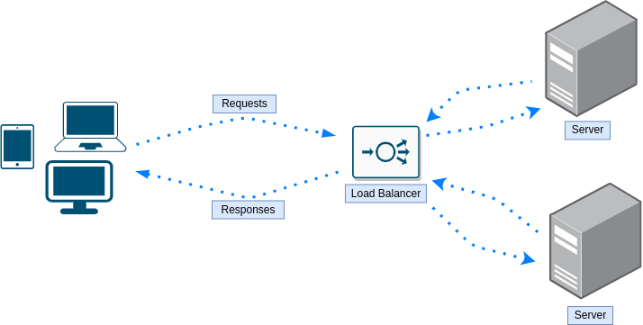

# Балансировщик нагрузки

- [Балансировщик нагрузки](#балансировщик-нагрузки)
  - [Что такое балансировщик нагрузки?](#что-такое-балансировщик-нагрузки)
  - [Консистентное хеширование](#консистентное-хеширование)
  - [Методы балансировки нагрузки](#методы-балансировки-нагрузки)
    - [Round Robin](#round-robin)
    - [Weighted Round Robin](#weighted-round-robin)
    - [Least Connection](#least-connection)
    - [Weighted Least Connection](#weighted-least-connection)
    - [Resource Based](#resource-based)
    - [Fixed Weighting](#fixed-weighting)
    - [Weighted Response Time](#weighted-response-time)
    - [Source IP Hash](#source-ip-hash)
    - [URL Hash](#url-hash)
  - [Sticky Sessions](#sticky-sessions)
  - [Проверки работоспособности](#проверки-работоспособности)
  - [Вопросы](#вопросы)

## Что такое балансировщик нагрузки?

[Wikipedia](https://en.wikipedia.org/wiki/Load_balancing_(computing)): «В вычислительной технике балансировка нагрузки — это процесс распределения набора задач по набору ресурсов (вычислительных узлов) с целью сделать их общую обработку более эффективной.»

Балансировщик нагрузки (load balancer) — очень важный компонент в проектировании систем. Возможно, он уже встречался в других разделах, например «горизонтальное масштабирование», так что понятно, что это очень распространённый компонент во многих архитектурах систем.

О балансировщиках нагрузки стоит помнить несколько вещей:

  * Обычно IP-адрес самого балансировщика нагрузки публичный, а адреса экземпляров/серверов — частные (нет причин позволять пользователям/клиентам обращаться к ним напрямую в обход балансировщика нагрузки)
  * Существует множество методов/алгоритмов того, как выполнять саму балансировку нагрузки

## Консистентное хеширование

TODO

## Методы балансировки нагрузки

### Round Robin

### Weighted Round Robin

### Least Connection

### Weighted Least Connection

### Resource Based

### Fixed Weighting

### Weighted Response Time

### Source IP Hash

### URL Hash

## Sticky Sessions

TODO

## Проверки работоспособности

TODO

## Вопросы

Зачем нужны балансировщики нагрузки?
 <b>
</b>

Какие существуют методы балансировки нагрузки?
 <b>

  * Round Robin
  * Weighted Round Robin
  * Least Connection
  * Weighted Least Connection
  * Resource Based
  * Fixed Weighting
  * Weighted Response Time
  * Source IP Hash
  * URL Hash
</b>

Правда или ложь? Обычно в базовых архитектурах серверы за балансировщиком нагрузки используют частные IP, а сам балансировщик нагрузки — публичный IP
 <b>

Правда. Это служит двум целям:

  * Нужно, чтобы все пользовались балансировщиком нагрузки :)
  * Это обеспечивает лучшую безопасность, так как никто не может обращаться к серверам напрямую. Таким образом, лучше защитить один компонент, чем заботиться о безопасности всех экземпляров/серверов за балансировщиком нагрузки
</b>

Обязательно ли нужен выделенный экземпляр балансировщика нагрузки, чтобы выполнять балансировку нагрузки? (например, с помощью метода round robin)
 <b>

Нет, можно использовать DNS-сервер.
</b>

Что такое балансировщик нагрузки уровня приложения (application load balancer)?
 <b>
</b>

На каких уровнях может работать балансировщик нагрузки?
 <b>
</b>

Что такое балансировка нагрузки с помощью DNS?
 <b>
</b>

Каковы недостатки алгоритма round robin при балансировке нагрузки?
 <b>

  * Простой алгоритм round robin ничего не знает о нагрузке и характеристиках каждого сервера, которому он перенаправляет запросы. Возможно, что несколько тяжёлых запросов попадут на один и тот же сервер, а другие серверы получат только лёгкие запросы. В результате один сервер будет выполнять большую часть работы и, возможно, в какой-то момент даже упадёт, потому что не сможет в одиночку обработать все тяжёлые запросы.
  * Каждый запрос клиента создаёт совершенно новую сессию. Это может быть проблемой в сценариях, где нужно выполнить несколько операций и сервер должен знать результат предыдущей операции, то есть по сути учитывать историю взаимодействия с клиентом. При round robin первый запрос может попасть на сервер X, а второй — на сервер Y с просьбой продолжить обработку данных, которые уже обрабатывались на сервере X.
</b>

Что такое sticky sessions? Каковы их плюсы и минусы?
 <b>
</b>

Объясните каждый из следующих методов балансировки нагрузки

  * Round Robin
  * Weighted Round Robin
  * Least Connection
  * Weighted Least Connection
  * Resource Based
  * Fixed Weighting
  * Weighted Response Time
  * Source IP Hash
  * URL Hash

 <b>
</b>

Какой метод балансировки нагрузки использовать для сайта электронной коммерции? Почему?
 <b>

Тот, который поддерживает sticky sessions, чтобы у пользователей, возвращающихся на сайт, загружались их данные, если серверы не используют общее хранилище.
</b>
